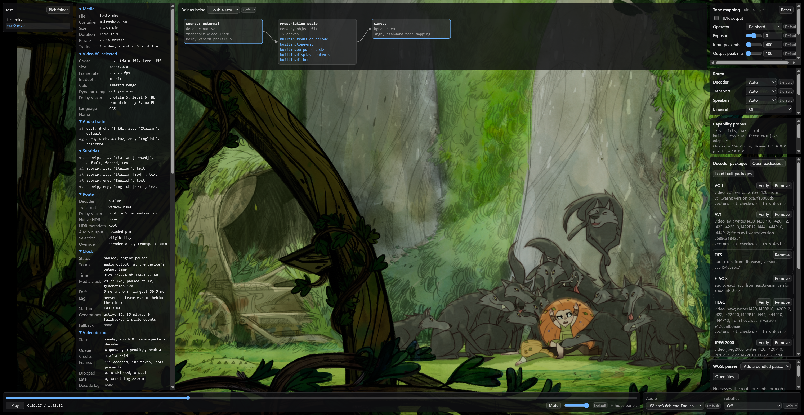

<h1 align="center">
  WebGPU Player<br>
  <sub><sup><sup>A WebGPU and WebCodecs media playback engine for the browser.</sup></sup></sub>
</h1>

This is a video streaming player backend built on top of WebGPU. It is therefore unhindered by the limitations of the stock HTML video players that get shipped with web browsers.

Benefits of this:

* HDR tone-mapping
* Multi-channel audio downmixing
* Non-native codec support
* Post-processing effects
* and a lot more.

Codecs and post-processing effects are supported through dynamically loaded WGSL + WASM modules. This means any codec or post-processing effect can be supported, without the need for clients to manually install additional software. Packs use GPU, CPU, or Hybrid architectures to achieve excellent playback performance, even with ultra-high-bitrate 4K media.


The documentation is a book in [docs/](docs/src/SUMMARY.md), written with [mdBook](https://github.com/rust-lang/mdBook). The current list of supported formats and codecs is [here](docs/src/codec-support.md).

### Sandbox Screenshot




## Requirements

Required:

- Node.js 24 or later and npm 11 or later.
- Git, GNU Make, and a POSIX shell (Git Bash on Windows).
- Emscripten 4.0.13 and rustup, to build the engine's own WebAssembly modules once per checkout.
  - Name an emsdk with `EMSDK`, which `emsdk_env` sets, or let `make -C wasm emsdk` (or `./build.sh`) install the pinned Emscripten into `bin/emsdk/`, which needs Python 3.
  - The repository pins Rust 1.96.1 with the `wasm32-unknown-unknown` target.

Only for specific tasks:

- CMake, Perl, GNU patch, (and on Windows: long path support), to build the decoder packages from the `wgpud/` submodule instead of installing their pinned release.
  - The decoder projects' FFmpeg and cargo trees pass 260 characters in a nested checkout.
  - Enable `LongPathsEnabled` and Git's `core.longpaths`; GNU Make and the MSVC linker that cargo uses must accept long paths too.
- Python 3.10 or later and the pinned FFmpeg and FFprobe build (`2026-03-01-git-862338fe31-full_build-www.gyan.dev`), to generate or check the codec vectors.
- MKVToolNix, for the Dolby Vision smoke media scripts.
- mdBook 0.5.4, to build the documentation.
- Chrome, Edge, or Firefox with WebGPU and WebCodecs, on a secure context (HTTPS or `localhost`), to run the engine.
  Firefox on Windows has no WebCodecs HEVC, so HEVC plays there only through a GPU decoder package.

## Quick start

```sh
npm ci
git submodule update --init wgpud wgpup   # The decoder and pass projects, which the checks need
make -C wasm all           # The engine's WebAssembly modules, once per checkout
npm run pinned-releases    # The pinned decoder packages and pass files, into bin/wgpud/ and bin/wgpup/
npm run typecheck
npm run lint
npm test
npm run build
```

The [Set up a checkout](docs/src/setup.md) section in the docs lists the toolchain, and [Embedding the engine](docs/src/embedding.md) demonstrates how a host uses it.

## Credits

- [Mediabunny](https://github.com/Vanilagy/mediabunny) (MPL-2.0) demuxes media and remuxes audio to fragmented MP4.
- [FFmpeg](https://ffmpeg.org/) (LGPL-2.1-or-later), built from a pinned revision, is the AC-3 and E-AC-3, the TrueHD and MLP, and the WMA decoder packages; the TrueHD package's 16-channel Atmos decoder is a port of its MLP decoder.
- The MIT KEMAR measurements of Bill Gardner and Keith Martin (MIT Media Lab, 1994) are the head-related impulse responses of the Atmos binaural renderer in the E-AC-3 and TrueHD packages.
- [libdcadec](https://github.com/foo86/dcadec) (LGPL-2.1-or-later) is the DTS decoder package, DTS-HD MA included.
- The `dolby_vision` crate from [dovi_tool](https://github.com/quietvoid/dovi_tool) (MIT) parses Dolby Vision RPUs.

## License

The engine's own code is MIT; see [LICENSE](LICENSE).
The engine ships no decoder.
The decoder packages are releases of [webgpu-player-decoders](https://github.com/alchemyyy/webgpu-player-decoders); those built from FFmpeg and libdcadec are LGPL-2.1-or-later, and every release carries their corresponding source; see [WebAssembly build](docs/src/decoders.md#licenses).
