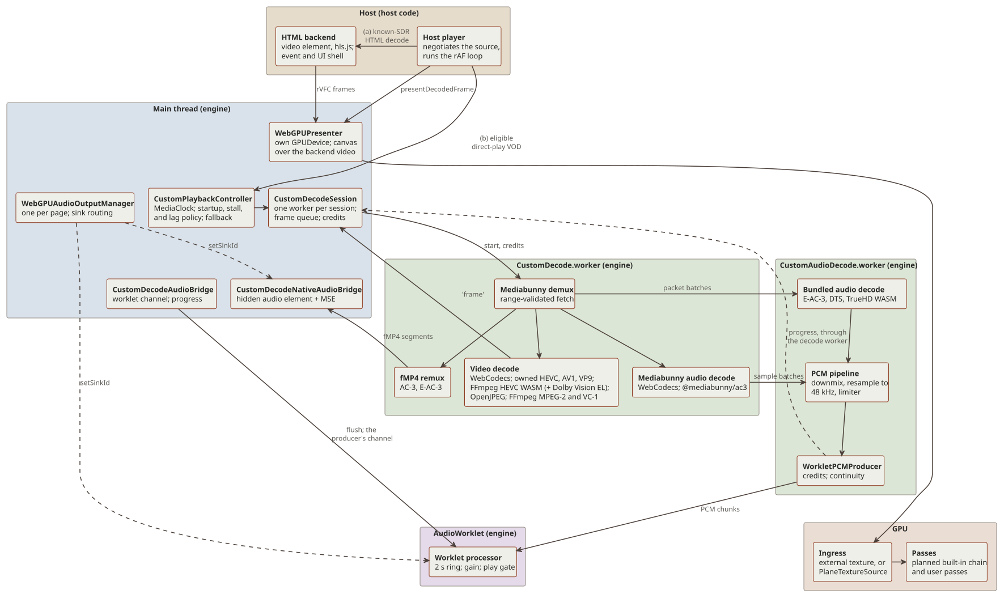
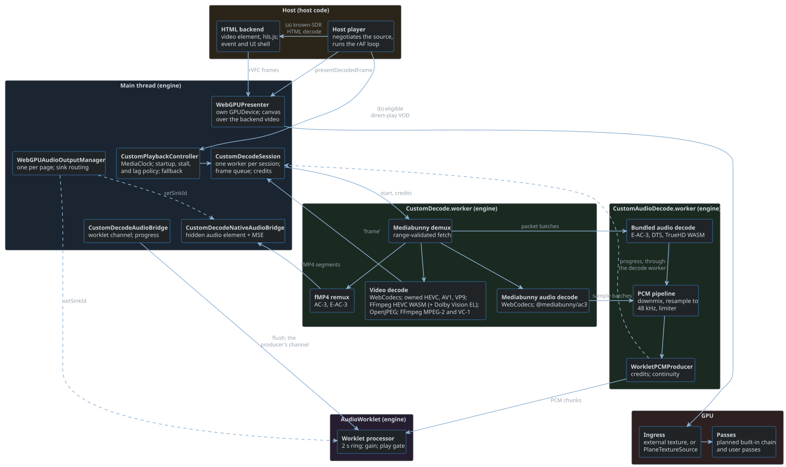
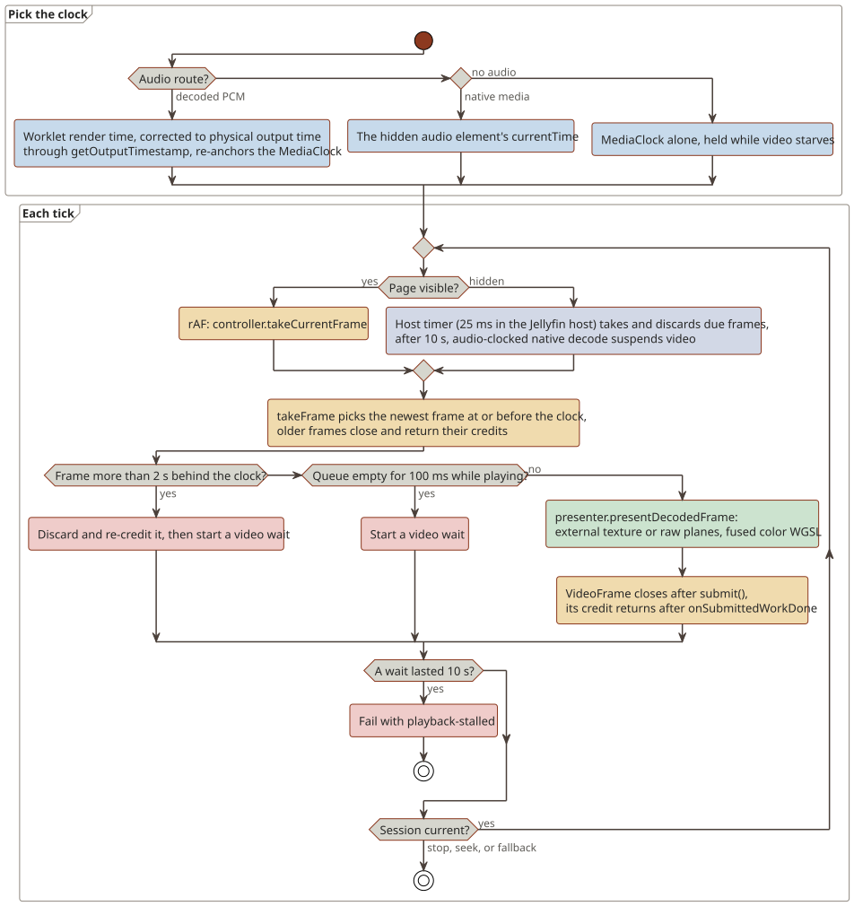
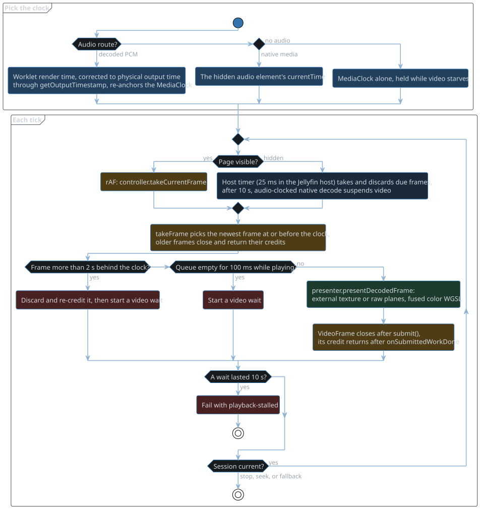
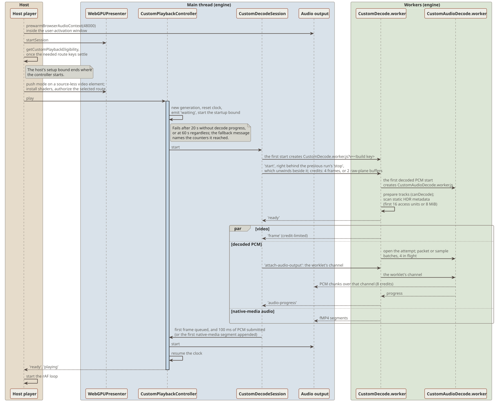
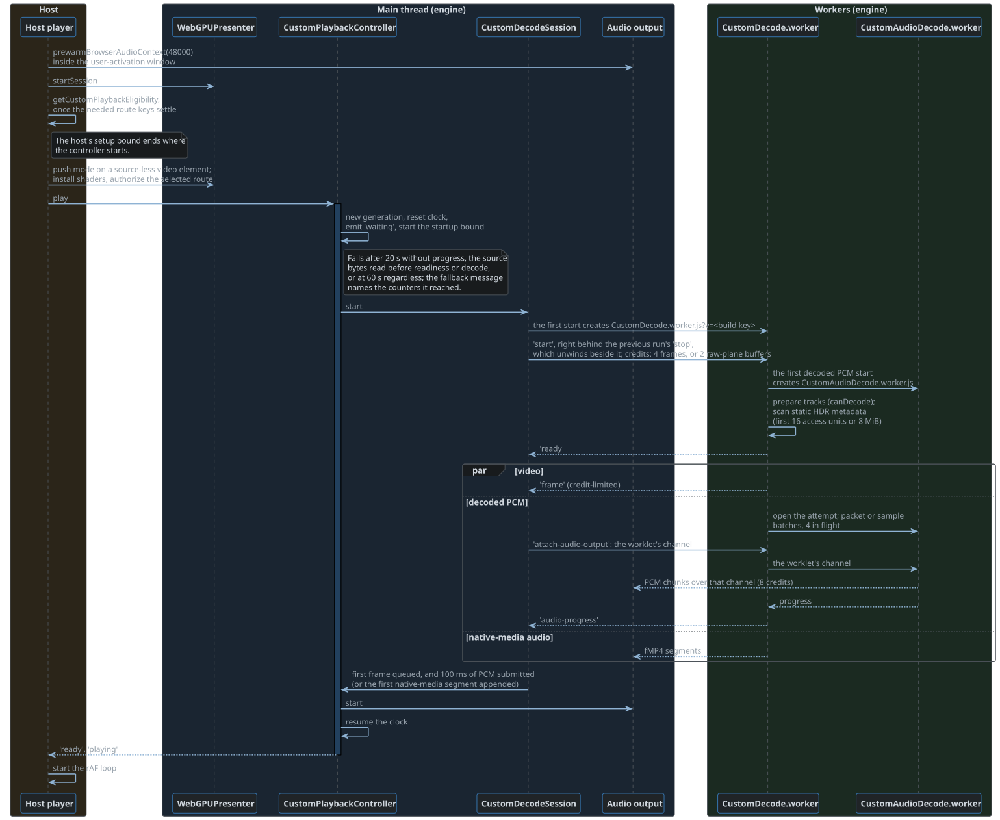
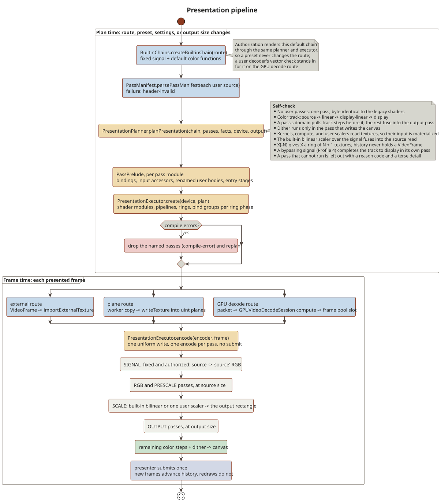
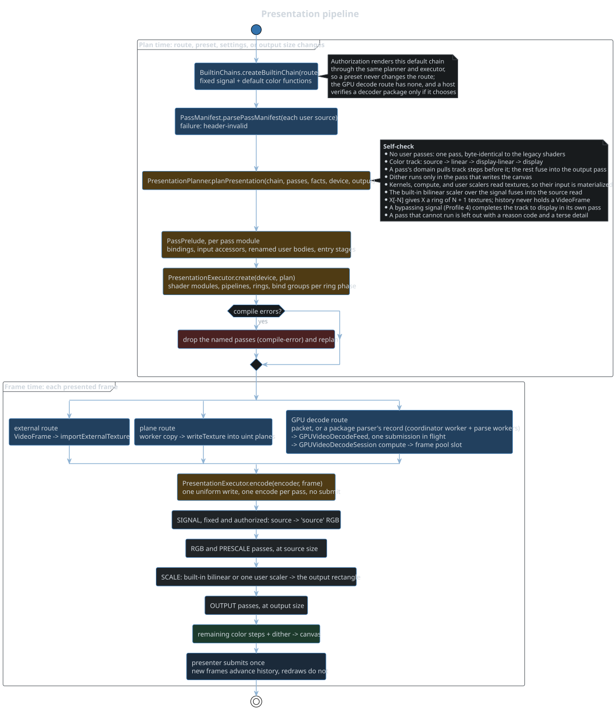

# Architecture

## Layers

A session takes one of two paths:

- (a) HTML decode with WebGPU presentation, for known-SDR input only.
  The `<video>` element or hls.js decodes, and the media element is the clock.
  Frames go rVFC, `importExternalTexture`, the identity route's one-pass plan, canvas.
  For HDR or unknown input the presenter is off and the `<video>` shows.
- (b) The custom pipeline, for eligible direct-play VOD.
  The worker posts `'frame'` messages (a `VideoFrame`, or raw planes in a pooled buffer, with Dolby Vision and HDR10+ metadata), and fMP4 segments for native-media audio.
  On the frame-pool route it decodes no video and posts compressed `'packet'` messages instead, which a GPU decoder package's WGSL decodes on the presenter's device into a frame pool that the presenter reads in place.
  For a package with a parser, such as the HEVC decoder project's, each `'packet'` carries one picture's record instead, which the package's parser writes on the worker's coordinator worker and its parse workers; a packet that holds several pictures, such as an AV1 temporal unit with hidden frames, posts one `'packet'` for each.
  Decoded PCM goes from the worker's audio decode worker straight to the AudioWorklet, over a channel the page hands over, and the page learns only each chunk's place and length (`audio-progress`).
  The frame loop, `CustomPlaybackFrameLoop`, takes the controller's current frame each animation frame and presents it.
  Decoded audio plays through an AudioWorklet in a pooled 48 kHz context, and AC-3 and E-AC-3 can play through a hidden `<audio>` element and MSE.

The host player and its HTML backend with any hls.js runtime are host code.
A host drives the custom pipeline through `PresentationSetup`, which gates the eligibility's presentation routes and configures the presenter for the chosen one, and runs one `CustomPlaybackFrameLoop` per playback.
Everything else in the diagram is engine code.
The plugin's book follows the Jellyfin host's half of a session.

The engine's sources follow the stages a custom session runs: `src/demux/` reads the container and shapes each track's packets and the metadata they carry, and `src/decode/` turns the packets into frames and PCM.
`src/presentation/` and `src/audio/` present the frames and play the PCM, and `src/pipeline/` runs the stages for each session (see [Module map](module-map.md)).

## Clock

- Decoded PCM: the worklet's render time, corrected to physical output time by `BrowserCustomAudioOutput` through `getOutputTimestamp`, re-anchors a `performance.now` `MediaClock`.
  After each flush the worklet renders silence from the flush position up to the first chunk's timestamp, so an audio track that starts later than the video still clocks from the start position.
  When the output starts, the clock holds its start for the output's estimated latency, so video moves when the first sample is heard.
- Native-media audio: `<audio>.currentTime`.
  A first fragment more than 40 ms after the start position parks the element at the fragment, and `play()` waits out the gap while the `MediaClock` runs alone.
- No audio: `MediaClock` alone, held while video starves.
  An audio track that ends before the video hands the clock to the `MediaClock` once its tail has played out.

Video is pulled: each rAF draws the newest frame at or before the clock, and hands the presenter its timestamp and the clock's rate, from which it measures the display's refresh rate.
While a plan deinterlaces, each rAF takes frames one frame ahead of the clock, the presenter shows the frame before the newest, and a tick that takes no frame draws a held frame's next field from history (see [Presentation](#presentation)).
While a plan holds a display-rate pass, each rAF takes frames one refresh ahead of the clock, and a tick that takes no frame redraws from history at its clock time.

## Startup of a custom session

1. The host runs `prewarmBrowserAudioContext(48000)` synchronously inside its play call (the user-activation window) and calls `presenter.startSession`.
2. The host runs eligibility, described in [Eligibility and routes](routes.md), once the authorization keys the source needs have settled.
   Its own setup bound should end where the controller starts, so the controller's startup bound applies after that.
3. The host gives the presenter a source-less `<video>`.
   The presenter enters push mode, and the host installs the shaders and authorizes the selected route through the presenter.
4. `controller.play` creates a generation, resets the clock, emits `waiting`, and starts the startup bound.
   It samples the decode counters every second and fails after 20 s without progress, or at 60 s regardless.
   The fallback message names the counters it reached, so a timeout shows where startup stalled.
   `CustomDecodeSession.start` posts the generation's `start` to the session's decode worker, the prebuilt `libraries/webgpu-player/CustomDecode.worker.js` keyed per build with `?v=`, which the session's first start creates.
   The worker's first start with decoded PCM audio spawns its audio decode worker, the prebuilt `CustomAudioDecode.worker.js` beside it, which it keeps for its life.
   Its first start for a package with a parser spawns its coordinator worker, the prebuilt `GPUDecoderCoordinator.worker.js`, which it keeps for its life too; that worker spawns the parse workers, the prebuilt `GPUDecoderParse.worker.js`, and keeps them while the package plays.
   Video gets 4 frame credits, 2 for raw planes, or 8 packet credits on the frame-pool route.
5. The worker prepares its tracks (`canDecode`), scans the static HDR metadata of the first 16 access units or 8 MiB, and posts `ready`.
   The frame-pool route skips `canDecode`, requires the codec its GPU decoder takes, and adds the track's decoder configuration record, such as an hvcC, as `codecPrivate`.
   With a parser it opens the attempt's parser before `ready`, which then carries the largest picture the parser declared in the codec private data.
   The session then creates the GPU decode session, or reuses the previous generation's when its decoder, format, coded size, bit depth, codec private data, and declared maximum match.
   It scans HEVC SEI on the native PQ route, and AV1 MDCV and CLL metadata OBUs when the first sequence header signals PQ and no RPU route is selected.
   Video and audio then stream concurrently.
6. The session is ready when the first frame is queued and at least 100 ms of PCM has been submitted, or, on the native-media audio route, when the first segment is appended.
   The controller also waits for the presentation prepared for the track's chroma format and size, which the session's `configured` event carries (see [Presentation](#presentation)).
7. `completeStartupIfReady` starts audio, resumes the clock, and emits `ready` and `playing`.
   The host then starts the frame loop.

## Steady state

| Thread | Work |
| --- | --- |
| main | rAF loop, controller, session, presenter, audio bridges, sink manager, MSE `<audio>` |
| worker, one per session | demux, video decode, raw copy, Dolby Vision and HDR10+ metadata, Mediabunny's audio decoding (WebCodecs and PCM), and fMP4 remux |
| audio decode worker, one per worker | audio decoder packages, the downmix in JavaScript, the resampler and limiter in WebAssembly, and the producer that feeds the worklet |
| coordinator worker, one per worker | a video decoder package's parser: each picture's plan and finish in decode order, such as the HEVC parser's motion derivation |
| parse workers, up to six per coordinator worker, two cores fewer than the device has | the units of a parser's pictures, such as HEVC's CABAC slice data, in parallel |
| AudioWorklet | 1024-frame chunks in a 2 s ring, gain, play gate, periodic telemetry |
| GPU | the presenter's queue, which the authorization probes and the frame-pool route's decoder share |

Video credits:

- `takeFrame` closes and re-credits older frames.
- A presented `VideoFrame` closes after `submit()`, but its credit returns only after `queue.onSubmittedWorkDone()`.
  This keeps the decoder's surfaces from starving.
- Every wait on queue work, this one, the frame-pool route's status readbacks, and the authorization probes', goes through `waitForGPUCompletion` (`GPUCompletion.ts`), which polls the device with an empty submit every 2 ms while the wait is pending.
  Firefox completes `onSubmittedWorkDone()` and `mapAsync()` only when its GPU process polls the device, at a later `submit` or every 100 ms, so without the polls a credit or a readback waited up to 100 ms there (see [Decisions](decisions.md#firefox)).
- In raw mode the posted buffer is the credit, and it returns through `recycle-frame`.
- On the frame-pool route a credit is a packet queued on the page, and it returns once the packet's decode work is submitted.
  With slicing on, which the host chooses through `createGPUVideoDecodeSessionFactory` and leaves off by default, a packet's decode work submits in slices of at most 96 dispatches, of about equal length, so a large picture's wavefront splits into several submits; off, every packet submits whole.
  `GPUVideoDecodeFeed` keeps up to two slices in flight, a whole packet counting as one, and submits the next once one completes or a status readback applies, so the GPU decodes on while the page learns of a completion, and presentation queues behind at most two slices of decode work.
  A reset, as a seek or a new video epoch makes, or a resync submits no more of the packet in progress.
  With a parser, a credit is one picture: the worker reads packets until their pictures run 8 ahead of the credits, a packet still parsing counting as one, so its parse workers stay busy, and a packet without a picture, such as a skipped leading picture, spends none.
  A presented frame returns its pool slot right after its submit, because the queue orders later decode work behind it.
- The owned HEVC, AV1, and VP9 paths read a packet only while they hold a credit, then wait up to 10 ms for the decoder to return a frame before reading the next.
  The credit is spent only when a frame is posted, so without that wait a hardware decoder, which answers a few milliseconds after taking a packet, received a whole group of pictures at once (see [Decisions](decisions.md#playback-robustness)).
  Steady playback therefore decodes one packet per presented frame, while seek preroll still runs at decoder speed, because each returned frame ends the wait.
- A hardware decoder returns a frame once its decode is queued on the GPU, not once the GPU ran it, so a preroll that reads at decoder speed queues decode work faster than the GPU finishes it.
  On the VideoFrame route a preroll therefore decodes in batches of 4 frames (`OWNED_VIDEO_PREROLL_BATCH_FRAME_COUNT`): the batch's last frame goes to the worker's decode fence (`VideoDecodeFence.ts`), and the packet after the next batch waits until the fence completes, so the decoder runs at most two batches ahead of the GPU and never idles between batches.
  The fence is a small WebGPU device of the decode worker's own that reads one texel of the frame and waits for that work, which waits for the frame's decode; the attempt whose first packet precedes its start creates it, and until it is ready, or where the worker has no WebGPU, frames pass unfenced.
  The frame that ends the preroll posts once its own fence completes, so its presentation never waits behind the preroll's decode work, and each wait ends after 250 ms at most.
  The trace records each wait as `video-decode-fence`.

Raw planes:

- A decoded `VideoFrame` is copied once, into a buffer of 256-byte-aligned rows, which the `frame` message transfers to the page.
- A run keeps spare buffers: those the page recycled and those of frames closed unposted.
  A drained frame or a copy takes a spare of its byte length, or a new buffer when none fits, and at most 2 spares of each byte length are kept, as many as the page can hold; a 4K 10-bit frame is about 25 MB.

Audio credits:

- Decoded PCM: the audio decode worker's `WorkletPCMProducer` owns the worklet's credit window.
  Chunks are 40 ms to 12000 frames, with 8 credits, so the credits can never hold more than the 2 s worklet ring.
  One credit returns per chunk the worklet consumes, with the chunk's buffers, which later chunks reuse.
  The audio decode worker reconciles decoder timestamps within 2 s before the resampler (see [Decisions](decisions.md#audio)), and fails the attempt as `decode-failed` beyond that.
  A gap, an overlap, or an overflow that reaches the producer is therefore an engine fault, and raises `audio-output-failed`.
- The worker sends each decoded PCM attempt's input in batches that close at 40 ms of media time or 64 inputs: compressed packets for a decoder package, or Mediabunny's decoded samples cut to the start.
  4 batches are in flight at once, and each returns its credit once the audio decode worker has rendered it, so demux runs at most a few batches ahead of the worklet's window.
- Native-media audio uses 2 MiB or 2 s segments, 2 credits, and appends at most 6 s ahead.

Lag guard, in `CustomPlaybackController`:

- A frame more than 2 s behind the clock is discarded and re-credited, and a video wait starts.
- An empty queue for at least 100 ms while playing also starts a wait.
- A wait of 10 s or more fails with `playback-stalled`.

Hidden page, through `setPageVisibility` and `drainBackgroundVideo`:

- No rAF runs while the page is hidden, so the host takes and discards due frames against the clock on a timer (25 ms in the Jellyfin host).
  Credits keep flowing and audio stays the master.
- After 10 s hidden, audio-clocked `native` decode sends `suspend-video`.
  The worker unwinds only its video attempt and releases the decoder.
  Once the audio track has ended, only video can reach the end of the stream, so video is no longer suspended and `audio-ended` resyncs a suspended decoder at once.
- On return, a suspended video, or one more than 2 s behind, gets `resync-video` at the clock.
  The worker restarts video alone at the preceding keyframe and skips frames before the target.
  Waits restart, so hidden time never counts toward `playback-stalled`.
- Every resync or suspension advances the video epoch.
  Frames carry `videoEpoch`, and the session closes frames of a replaced epoch and returns their credits.
- A reclaimed WebCodecs decoder (`QuotaExceededError`) posts `video-interrupted`.
  Video resyncs at once when visible, and on return when hidden.
- When audio outlasts the video track, the worker posts `video-ended` before the run's `ended`, and the controller holds the last frame without waiting, stalling, suspending, or resyncing.

Geometry: `WebGPUPresenter.bindLayoutHandling` invalidates layout on resize observers, class and style mutations of the video and its ancestors, CSS motion events, window resize, seek, and refresh.
The backing size is the CSS size times the device pixel ratio, capped by `maxTextureDimension2D`.

## Presentation

- Every route presents through the pipeline in `src/presentation/passes/`.
- A route's built-in chain is its fixed signal, which reads the source and reconstructs Dolby Vision, and its default color functions: transfer decode, tone mapping, output encode, display controls, and dither.
- `planPresentation` arranges the chain and any user passes into GPU passes.
  Without user passes every route is one pass, which renders exactly as the legacy fused shaders did.
- `PresentationExecutor` owns a plan's pipelines, textures, history rings, and bind groups.
  A frame costs one uniform write, the source's import or upload, and one encode per pass, and the presenter submits once.
- A new plan compiles while the previous executor keeps presenting, and replaces it when ready.
- The device keeps the most recently used 64 compiled passes (`PresentationPipelineCache.ts`), keyed by their WGSL, bind group layout, and target format, so an executor built again for passes it compiled before, in a replan or in a later session on the kept device, compiles nothing.
- A starting generation builds the plan its track declares before the first frame is due: the session's `configured` event carries the chroma format and coded size of the worker's ready response, the controller hands them to the preparer the frame loop registered (`setVideoPresentationPreparer`), the presenter plans with them as with a frame's facts (`prepareDecodedVideo`), and the generation reports ready only once that executor is installed.
  The first frame of those facts then presents without a replan, and a frame that differs replans as before.
- User passes come from `WebGPUPresenter.setPresentationPreset`.
  A pass that cannot run is left out of the plan, and `getPresentationPlanReport` names it with a reason code and a terse detail.
- The spine starts with the plane stages, `LUMA`, `CHROMA`, and `NATIVE`, which hold the signal's planes as normalized codes (see [Planes](new-pass.md#planes)).
  Each signal offers its planes (`SignalDefinition.planes`): its own reads of the luma and chroma codes, chroma's siting, and its conversion to 'source' RGB.
  A plan reads a plane apart into a texture only for a pass that reads it, and when a pass replaced a plane, a merge pass converts the planes into the spine's first image at luma's size, reading each plane no pass replaced from the source, so it converts exactly as the signal does.
  The raw and frame-pool routes hold the decoded planes, and the Dolby Vision routes offer none.
  The external routes derive them from the browser's RGB through the stream's own matrix and range (`SignalPlanes.transformCode`), the external HDR route from the codes its signal recovers, with chroma at the stream's subsampling.
  The frame-pool route reads a pool slot in place, whose planes are padded to 64 rows and columns, and clamps every tap to the frame's visible picture, which the executor writes into the slot's layout uniform as it binds the frame, so a picture's edge repeats as on the raw route.
- Every signal reads 4:2:0 chroma at the location the stream declares, and 4:2:2 chroma on its left luma column; the external routes derive chroma at those sites.
  The decode worker reads the subsampling and the location from the track's decoder configuration (`VideoChromaFormat`), from its first key packet's in-band SPS where an H.264 or HEVC track's configuration holds none, and MPEG-1 as center-sited 4:2:0; its ready response names them, and every frame of every output mode carries them, so the presenter plans with them without a host fact.
  A deinterlacing plan derives them from its deinterlaced image through the same transform (`SignalPlanes.imageCode`), so plane passes run on interlaced sources without reading the source again.
- The planes hold the frame's visible samples (`PlanFacts.sampleWidth` and `sampleHeight`, the `luma.width` and `luma.height` facts), and chroma's extent is luma's over the subsampling divisor, as libplacebo sizes plane rects; the presenter plans again when the frame's sample size changes while preset passes plan, and when the stream's chroma changes.
- Every image the plan holds has a plan-time offset, as libplacebo's texture rects place mpv's textures: chroma starts at its siting, a pass's output takes the hooked image's offset scaled to its size plus its declared `offset`, and `offset: align` returns it to the reference grid.
  No read is shifted; the merge resamples chroma onto luma's grid through both offsets, and the scaler corrects its image's offset within its resample.
- A pass file's texture blocks reach the planner inside the manifests of the passes that bind them, and the plan names each by its content identity (`PresentationPlan.passTextures`).
  The presenter's `PassTextureCache` uploads a block when a plan first binds it, hands the uploads to `PresentationExecutor.create`, and after installing an executor releases the uploads neither its plan nor the preset holds.
- A pass's `when` reads its parameters, and a `const` parameter compiles into the plan's modules, so a change to either builds a new plan (`PlanRequest.parameterValues`), which the executor of an unchanged plan adopts without rebuilding; any other parameter is a uniform write.
- The prelude gives a body that calls them the source's transfer function in mpv's scale of linear light (`BuiltinChain.linearLight`, from the built-in transfer decode's code) and its planes transform.
- Temporal history advances only on new frames; redraws from history, of a deinterlacing or display-rate plan, do not advance it.
  It resets on a seek, a new generation, a video epoch change, and a frame whose timestamp goes back or jumps past 2.5 frame durations.
- The `frame.rate` fact is the stream's declared frame rate (`PresentationInput.getPresentationFrameRate`): its average frame rate, else its real frame rate when the average is missing or at least 1000, which `configurePresentationColorPipeline` carries as `PresentationColorPipelineConfiguration.frameRate`.
- Authorization renders the default chain through the same planner and executor, so a preset never changes the route.
- With HDR output enabled by the host, an HDR source presents extended-range values on an `rgba16float` canvas.

### Deinterlacing

- An interlaced stream presents through `Presentation deinterlace`, the engine's yadif pass (`passes/builtin/DeinterlacePass.ts`; see [Decisions](decisions.md#deinterlacing)).
- The presenter asks for it (`PlanRequest.deinterlace`) once the stream's facts or any frame call the video interlaced, while the mode is not `off`.
  A Dolby Vision route never asks, since its profiles are progressive.
- The planner places it before every stage: the signal renders into `signal`, a ring of three frames at the frame's visible size in `rgba16float`, and the pass reads the frame it shows, the one before it, and the one after it, and writes `deinterlace` at the same size, which the rest of the spine takes.
- It deinterlaces the signal's 'source' RGB per channel in f32, so one pass serves every route but Dolby Vision's, 8 to 12 bits and every chroma format.
- Plane passes take their planes from `deinterlace`, through the signal's transform, as mpv's user shaders see the planes a deinterlacing filter wrote.
- A progressive frame passes through untouched, as does a frame beside a progressive one that repeats a field, as yadif's `deint=interlaced` does.
- The `presentation` uniform's `fieldState` word (`PRESENTATION_FIELD_STATE`) names what shows: whether the pass interpolates, the field shown, whether it is its frame's second, whether the shown frame is the one before the newest, and whether the frame the signal reads now is interlaced.
- On the raw and frame-pool routes a deinterlacing plan's signal reads an interlaced frame's 4:2:0 chroma within each field, at MPEG-2's interlaced siting, so a field never takes the other field's colors.
  A native `VideoFrame` arrives as an external texture whose chroma the browser upsampled progressively, so its fields share chroma rows.
- Each frame carries its own fields (`VideoFrameFields`): a GPU decoder's `reportPictureFields` report, else its parser's `parser_picture_fields` word, else the container's scan, Matroska's FlagInterlaced and FieldOrder or an MP4 sample entry's `fiel` box.
  A frame without fields takes the stream's scan from the host's facts, `FieldOrder` and then `IsInterlaced`; a frame of unknown scan presents as it is.
- `DeinterlaceTimeline` mirrors the ring and picks the draw for a clock time: a frame's first field at its own time, and at double rate, the default, its second field halfway to the next frame's time, rounded down to a whole microsecond.
  Single rate shows each frame's first field only, and `off` presents frames woven, as decoded.
- Deinterlacing reads the frame after the one it shows, so the frame loop takes frames one frame ahead of the clock (`getFrameLookaheadMicroseconds`), and the presenter shows the frame before the newest.
  The clock and audio never move: decoding runs one frame further ahead.
  After a reset the first frame shows at once without a frame after it, and at the end of a stream, or while decoding falls behind, the newest frame shows once the clock reaches it, as FFmpeg's yadif repeats its last frame.
- A tick that takes no frame draws the held frame's next field from history (`presentHeldFields`), without a source, so passes that read the source are skipped.
- `setDeinterlaceMode` switches between double rate, single rate, and off; only a switch to or from `off` builds a new plan.

### Display rate

- The presenter measures the display's refresh rate (`DisplayRefresh`) from the animation frame times the frame loop hands `recordAnimationFrame`: a least-squares line through the times over refresh counts, which counts skipped refreshes and averages timer coarsening up to 1 ms.
  It reports an interval once at least 30 frames fit the line with a relative standard error of at most 0.02%, over a window of 240 refreshes.
  A frame more than 0.4 intervals off the line, as after a move to another display, starts the measurement over, and a gap over 500 ms, as a paused loop leaves, starts a new window; the last measurement holds until the next is precise.
- The `display.rate` fact is that rate, 0 until measured, and the presenter plans again when it moves more than 0.1% (`DISPLAY_RATE_REPLAN_TOLERANCE`) from the rate the plan read, while a preset pass's `when` reads it.
- A pass with `rate: display` plans only while frames come from the frame loop (`PlanRequest.displayRateAvailable`), and not in a deinterlacing plan; otherwise it is left out as `display-rate-unavailable`.
- In a display-rate plan (`PresentationPlan.displayRate`) the pass that reads the source writes a texture rather than the canvas, and a display-rate color step gets a pass of its own, `Presentation color`.
- The frame loop takes frames one refresh ahead of the clock (`getFrameLookaheadMicroseconds`), so the frame that starts within a refresh is in history when the refresh draws.
- A tick that takes no frame redraws from history at its clock time (`presentHeldFields`), unless the last draw was at that time, from `PresentationPlan.historyDrawStart`, the first pass with a display-rate step: the passes that read the source and the passes before it are skipped, since no draw of the frame changes their outputs.
  After a new executor is installed, nothing redraws until a frame's submission validated it.
- The `presentation` uniform's `refreshSeconds` is the media time one refresh covers, the measured interval times the rate the clock advances at, which the frame loop hands over as 0 unless playing, and `targetOffsetSeconds` the clock time the draw presents at minus `timestampSeconds`, subtracted in double precision.
  The lookahead follows it, so a paused or seeking playback takes no frame ahead of the clock.
- The uniform's `frameDurationSeconds` is the media time between frames (`FrameInterval`): the slope of a least-squares line through the last 24 new frames' timestamps over their frame counts, which evens out millisecond-rounded timestamps to inside 0.1% within 8 frames, where a mean of 16 frames' own durations strayed 0.2% on such a stream.
  The frames the loop skipped between two it drew count by the last frame's own duration, else by the line, and a frame more than 0.4 frames off the line, as after a change of frame rate, starts the line over from the frame before it; a seek, a new generation, or a history discontinuity starts it over too.
- Telemetry's presented media time is the frame the clock falls in: the one before the newest until the clock reaches the newest.
- A history reset clears the display-rate frames.

## Transitions

- Seek: a new presentation generation, then `controller.seek`, which stops the running generation and starts a new one at the target in the same worker.
  The owned HEVC, AV1, and VP9 paths start at the preceding key packet, and drop the frames before the target except the one the target falls in, which presents first; a frame at the target itself presents first with nothing before it.
  The preroll decodes in fenced batches (see Video credits above).
  DTS and TrueHD use a 1 s preroll.
  The host drops stale seek results by its own revision.
- Audio track switch: eligibility runs again.
  If the source is no longer eligible, the session renegotiates; otherwise it restarts as a seek at the current time.
  Downmix gain changes apply live with a 20 ms ramp.
- Audio output layout switch (`controller.reconfigureAudioOutput`): a new device layout, force stereo, or a new downmix algorithm restarts only decoded audio while video keeps playing.
  The requested layout applies whole to a source a package renders as objects (`audioRendersObjects`); for any other source its floor is a ceiling applied to the decoded source layout, which the worker reports with `audio-source-format`: three channels, 5.0, and 5.1 take 5.1, 6.1 and 7.1 take 7.1 or fold into 5.1, and anything else mixes to stereo.
  A request that keeps the layout only records its downmix for later restarts, and a newer request replaces a pending switch.
  A binaural headphone change that keeps the layout switches live: `session.updateAudioBinaural` reaches the attempt's package as `renderBinaural` before its next packet.
  1. The controller stops the output and picks a target 250 ms ahead of the clock (the current time when paused or waiting on an audio underflow).
  2. `session.resyncAudio` stops the old bridge and advances the audio epoch.
     `BrowserCustomAudioOutput.reconfigure` retires the worklet, sets `destination.channelCount`, and leases a worklet with the new channel count on the same context and sink.
  3. The worker gets `resync-audio`: it closes the audio decode worker's attempt, whose channel to the replaced worklet closes at once, and opens a new one at the target with the new worklet's channel and a rebuilt downmix, resampler, and limiter (DTS and TrueHD keep their preroll).
     Samples and credits are tagged with the epoch, so stale ones are dropped.
  4. Once the new epoch has buffered 100 ms, the output starts when the clock reaches the target.
     Audio telemetry does not move the clock in between.
     A clock that waited on the old output's underflow resumes at this point, because the new output starts full and never reports a recovery.
     A pause holds the start, and resume counts down to the target again.

  A failure, or a fill that exceeds 5 s, falls back to HTML in the same session.
  The host triggers the switch, for example when the output reports `sinkchange` with a different channel count.
- Pause: the clock pauses and the worklet is gated to silence.
  The AudioContext keeps running; the pool suspends it only when idle.
  A playback rate other than 1 with audio falls back to the HTML player in the same session.
- GPU device loss: one recovery per session.
  The new device must re-authorize the active HDR, Dolby Vision, or raw route before it draws.
  If that fails, `device-recovery-failed` falls back to HTML.
  The frame-pool route never recovers, because its decoder's references lived on the lost device, so it falls back the same way.
- Audio sink change (`WebGPUAudioOutputManager`): the default sink is `setSinkId('')`.
  The fallback chain is the selected device, then the default, then the first enumerated device.
  A route whose sink ID is unchanged is left alone, because browsers ignore a same-ID `setSinkId`.
  Decode, worklet, and queues never restart for a sink change.
- Output device recovery: Chromium binds an AudioContext created with no output device to a fake output for its whole life.
  The pool detects such a context at creation and closes it on release instead of pooling it.
  While one is in use, or a context has reported `error`, the router polls `enumerateDevices()` once a second, because Chromium sends `devicechange` only with microphone permission.
  Each poll that lists an output runs a recovery pass, without a retry limit: it rebuilds the sink with `setSinkId({ type: 'none' })` and then the requested sink, and resumes.
  Polling runs only while the page is visible; a hidden page stops it and probes again as soon as it becomes visible.
  The rebuilt sink reports `sinkchange`, so a surround device switches the session's layout at once.
- Re-detect output (`WebGPUAudioOutputManager.redetectAudioOutputs`, offered by the host's settings): rebuilds every AudioContext sink so the browser re-reads the device.
  Chromium moves a default output to a new device without telling the page, which leaves a stale channel count until a rebuild.
- End of stream: the audio decode worker flushes the resampler and limiter tails, and the worker posts `ended`.
  The controller emits `ended` once the bridge and worklet queues are empty, the output time has reached the end, and the video queues are empty.
  On the frame-pool route the worker's last packets still decode on the page, so the session ends its video only once the GPU decoder drained its last frame.
- Audio ends first: the worker posts `audio-ended` (epoch-tagged) when an audio attempt finishes while video continues, and ends the run only once the video track itself has ended.
  The worklet's final underflow releases the audio tail instead of starting an audio wait that would end in `playback-stalled`.
  Unlike the end of stream drain, video waits stay in force and an uncorrelated output does not pause the clock; once the tail is out, video starvation holds the clock.
  The end also completes a start or audio resync that has no PCM left to wait for.
  A native-media session sends `endOfStream`, so `<audio>` plays out, and the clock then runs without the element.
- Generation handoff: the session's worker runs one generation at a time, and every run posts `stopped` last.
  A new `start` goes out right behind the previous run's `stop`, and the worker starts it at once, while the stopped run unwinds beside it; `session.stop()` does not wait for `stopped` either.
  A stop closes the run's decoders and audio attempt and cancels its reads, and the next run's parser pipeline replaces the stopped run's on the coordinator worker, so the next run never waits on the stopped one.
  A run's `stopped` waits until the audio decode worker released the run's decoded PCM attempts, and the page drops a retired run's frames, packets, and audio as stale.
  A worker is replaced, never reused, after a generation fails, a message fails validation, or the worker crashes; a start on another video decoder backend also gets a new worker.
  A retired run that does not post `stopped` within 10 s, or a retired run's failure, replaces the worker at the next start, and such a worker terminates once it holds no run; a start that would leave more than 4 retired runs unwinding in the worker takes a new one.
  A lost audio decode worker fails its run's decoded PCM as `audio-output-failed`, and the decode worker spawns another for its next run.
- Stop: `controller.destroy` stops the generation, releases the worklet and the sink lease (1.5 s cap), and ends the presenter session.
  Once the stopped run posted `stopped`, the decode worker, with its parser coordinator, parse workers, and audio decode worker, waits for the page's next session, as the next item of a queue starts one, and terminates if none takes it within 30 s (`releaseIdleCustomDecodeWorker` ends the wait at once).
  A worker unfit for another generation terminates instead.

## Fallback and renegotiation

`pipeline/CustomPlaybackController.ts:getFallbackDisposition` decides what a failure does:

| Disposition | Reasons |
| --- | --- |
| HTML player, same session | audio-output-failed, audio-output-unavailable, lifecycle-failed, playback-rate-unsupported |
| Renegotiate the source | decode-failed, ended-before-ready, network-failed, playback-stalled, range-unsupported, source-unsupported, startup-timeout |

- The host carries out each disposition, and may renegotiate on every reason when its HTML player cannot play the source.
- Failures in the host's wrapper (presenter, frame submission, rAF) are `lifecycle-failed`.
- Fallback never selects another player.

Every stale callback is dropped by a generation or revision check:

- The host: its own generations and revisions.
- The controller: `activeGeneration` and `fallbackGeneration`.
- The session: a generation record per generation, which its worker's messages must match.
- The worklet: its flush generation.
- The presenter: `deviceResourceEpoch`, the color and layout revisions, and `fallbackLatched`.

## Gotchas

- External textures of high-bit-depth frames are 8 bits per channel in Chromium (see [Decisions](decisions.md)).
  Authorization tolerances follow: external HDR 10/255, external Dolby Vision 8/255, raw 3/255.
- The native external HDR route rewrites the color of the `hvcC` SPS and of every in-band SPS, in delta packets too, to BT.709 at the stream's own range, and the shader recovers the 10-bit codes (`Y*876+64`, `C*896+512`), a full-range code as its limited-range equivalent.
  A frame with a colorSpace that is not neutral, BT.709 at either range, latches `decoded-frame-color-mismatch`.
- The raw route checks each frame's colorSpace against the metadata, and a null member is unspecified, so it never contradicts.
  SDR also matches a `smpte170m` transfer, and HLG a `bt709` transfer on BT.2020 primaries.
- WebGPU presentation on the HTML path is SDR only: a `<video>` external texture is browser-converted sRGB.
- A deinterlaced native frame's chroma is the browser's progressive upsampling, which blends the two fields' chroma rows; only the raw and frame-pool routes read chroma within each field.
- Worker track indices are container ordinals, not Jellyfin `MediaStream.Index`; the streams Jellyfin lists for external files (`IsExternal`) take none.
- Every seek, audio switch, and paused repaint starts a new run in the session's worker, and each run opens its input again, over the last run's URL source when it reads the same URL (`demux/URLSourceRetention.ts`).
  The source keeps its cache, the container's header and index pinned in it, and its open responses, so a seek reads the header and index from memory and reads on near where the last run stopped.
  A run's stop cancels the reads its input still waits for; a failed run's source, or one no run takes within 5 s, is released, and only by the run that took it last.
  After the first preparation over a source, its read-ahead holds 5 s of media and its cache 15 s, at the media's size over its duration, within 8 to 64 MiB and 32 to 192 MiB; a file's cache stays 32 MiB.
- Decoded PCM gain (volume cubed times normalization) is applied after the limiter and is not capped, so a boost can clip; clipping is counted.
  The native-media route caps gain at 1.
- `DecodedVideoGeometry` locks the first decoded size of a run, with a 64 px tolerance.
  A later size change fails the session.
- The negotiated `maximumCoded*` is Jellyfin's cropped `Width` and `Height`, while containers and decoders report block-aligned sizes (mkvmerge can declare 2080 lines for a 2076-line HEVC picture).
  Route checks allow the same 64 px through `exceedsNegotiatedCodedSize`.
- A media server's cross-origin 206 may hide `Content-Range`, as Jellyfin's stream endpoint does.
  Such a response passes only from a path the URL source's `hiddenContentRangePathPattern` names, which the host sets, and only with a `Content-Length` within the requested range (`demux/HTTPRangeResponse.ts`); a source without a pattern needs every 206 to show its `Content-Range`.
  The Jellyfin plugin sets the pattern of `/Videos/{id}/stream` on the stream URL it plays.
