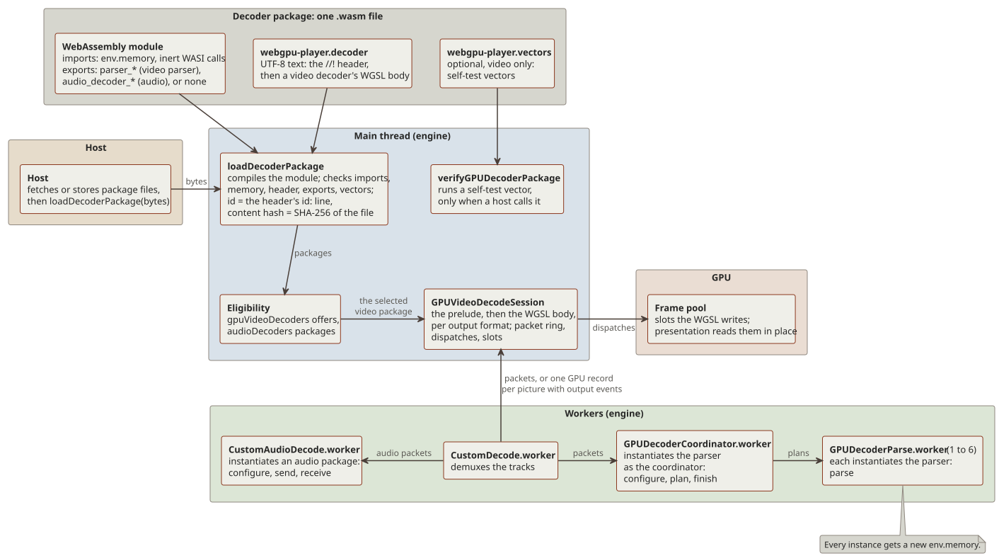
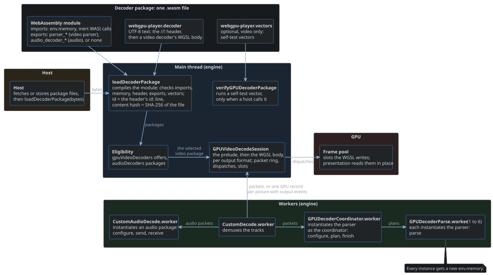
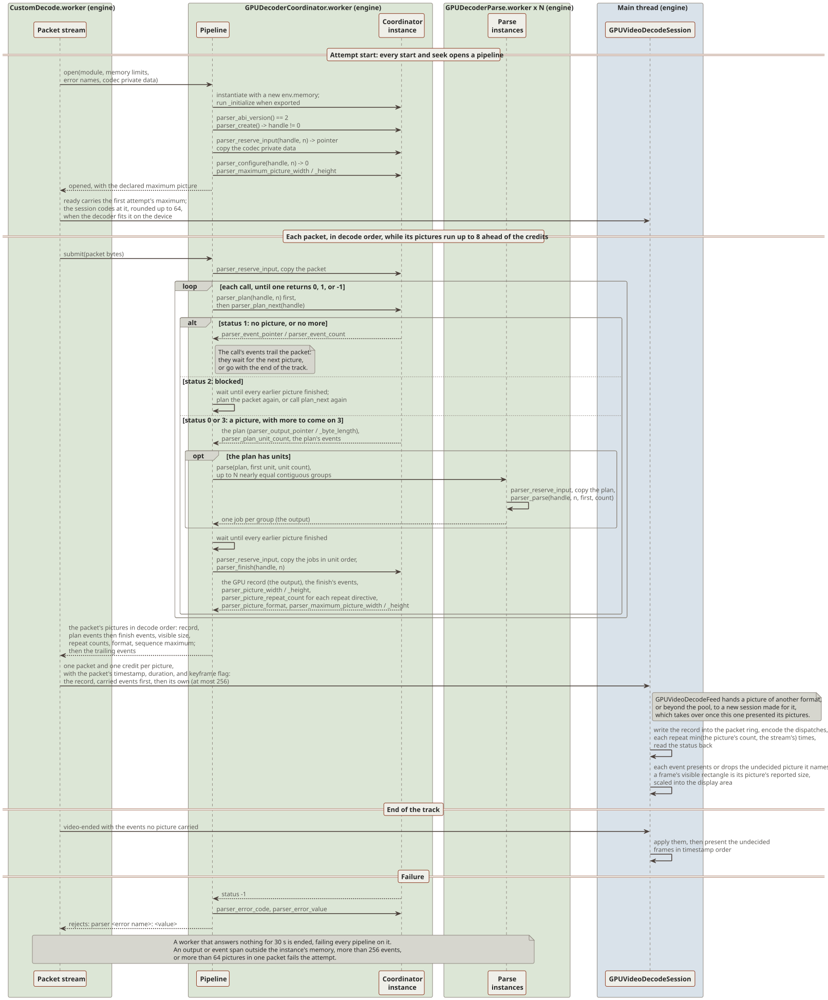
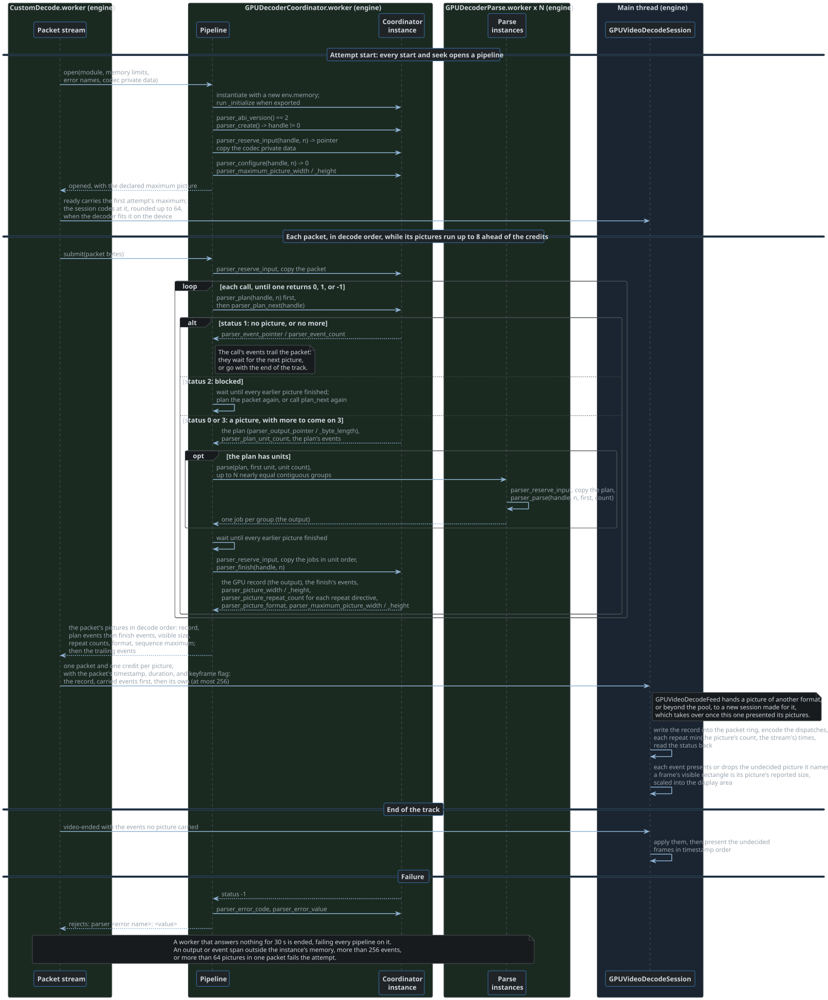
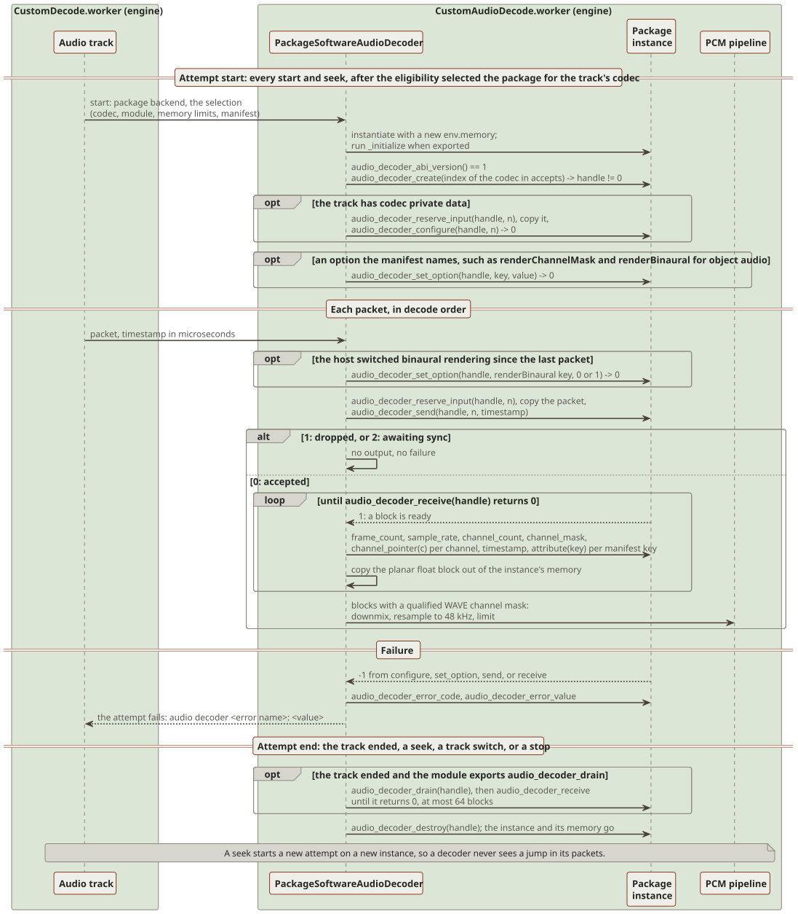
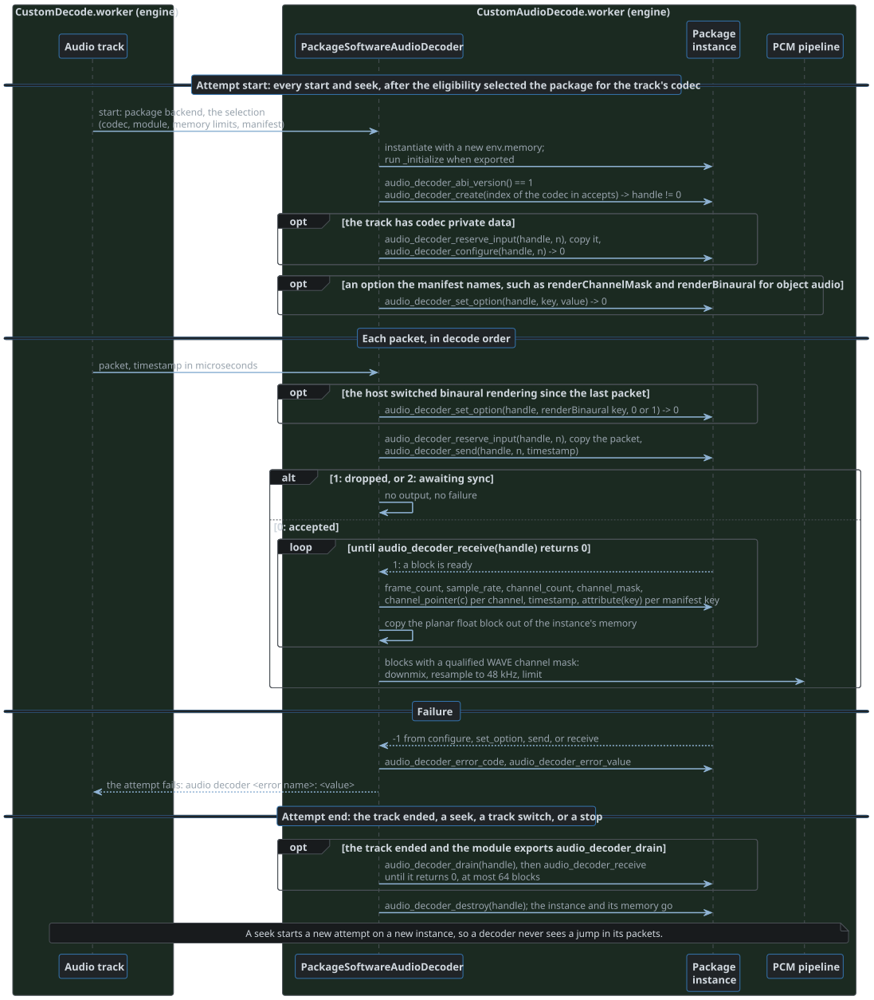
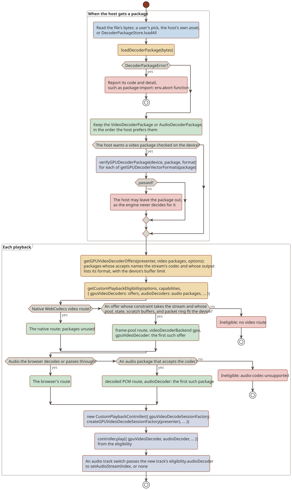
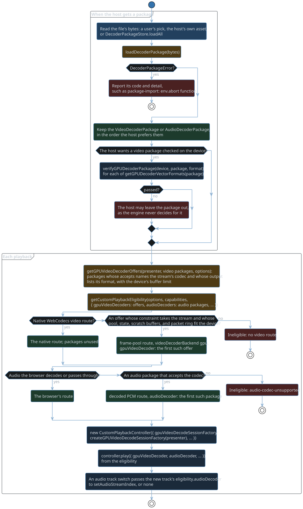

# Decoder packages

A decoder package is one `.wasm` file that adds a video or an audio decoder to the engine.
The engine has no decoder package of its own and names none: a host hands it the packages it loads, at runtime, and the engine reads what each one decodes from the package itself.
Packages are a fallback beside the browser's decoders: a native WebCodecs route comes first, and a package plays only what the browser cannot.
A package carries no JavaScript, so a host may load packages from anyone.

<div class="diagram">
<a class="diagram-light" href="diagrams/decoder-package.light.svg"></a>
<a class="diagram-dark" href="diagrams/decoder-package.dark.svg"></a>
</div>

## The package file

A package is a WebAssembly module with custom sections; `src/decode/packages/DecoderPackageFormat.json` names them for the engine and its tools.

| Section | Holds |
| --- | --- |
| `webgpu-player.decoder` | Required: UTF-8 text, a `//!` header and, for a video decoder, the WGSL body after it |
| `webgpu-player.vectors` | Optional, video only: the package's self-test vectors |

The header's `decoder:` directive makes the package a video or an audio decoder.
A video package's module is its parser, when its header declares `parser:`, or a module without code; an audio package's module is the decoder.

### Identity

A package's id is the one its header's `id:` directive declares, and every version of the package keeps it.
Its content hash, the lowercase hexadecimal SHA-256 of the whole file, tells its versions apart.
`src/decode/packages/DecoderPackageIdentity.ts` holds the rules.

- Every header, video or audio, declares `id:` once.
- An id is 1 to 64 characters: lowercase ASCII letters and digits, in runs joined by single hyphens, such as `av1`, `jpeg2000`, or `hevc-main-10`.
- A header without one fails as `directive-missing`, a malformed one as `id-syntax`, and a longer one as `id-length`, so the package fails to load as `package-manifest`.
- A host's store keeps one file per id, so a new version replaces the old one.
- The engine keeps what it derives from a package, such as compiled pipelines and parse workers, by id with the content hash as the version, so a new version replaces what the old one left, and nothing counts or ages entries out.

`loadDecoderPackage(bytes)` in `src/decode/packages/DecoderPackage.ts` compiles the module and checks the package in this order.
It rejects with a `DecoderPackageError` whose message is the failed check's code and a terse detail.

| Code | Check |
| --- | --- |
| `package-invalid` | The bytes compile, and their binary reads |
| `package-section-missing` | The decoder section exists |
| `package-section-repeated` | No section appears twice |
| `package-encoding` | The decoder section is UTF-8 |
| `package-import` | The module imports only what packages may import, its memory once |
| `package-memory` | The memory is imported, bounded, neither shared nor 64-bit, and not defined by the module |
| `package-kind` | `decoder:` is `video` or `audio` |
| `package-manifest` | The header parses, its id included; the detail carries the header's own code, detail, and line |
| `package-export` | The module exports every function of the interface its header declares |
| `package-vectors` | The vectors section reads, and holds only formats the decoder writes; an audio package carries none |

## Imports and memory

A package's module may import only these:

- `env.memory`, once: the memory the engine creates for each instance.
- `env.emscripten_notify_memory_growth`.
- From `wasi_snapshot_preview1`: `args_get`, `args_sizes_get`, `clock_time_get`, `environ_get`, `environ_sizes_get`, `fd_close`, `fd_fdstat_get`, `fd_read`, `fd_seek`, `fd_write`, `proc_exit`, and `random_get`.

The engine's WASI calls are inert: arguments and the environment are empty, output goes nowhere, reads and seeks fail, the clock reads zero, randomness is zero bytes, and exit traps the call.
`src/decode/packages/DecoderPackageImports.ts` holds the whitelist and the stubs.

A parser and an audio decoder must import their memory as `env.memory`; a video package without a parser imports none.
Each instance gets a new memory with the module's declared initial pages, which may not exceed 16384 pages (1 GiB).
Its maximum is the module's declared maximum, or 16384 pages when the module declares none or more.
A module that exports `_initialize`, as a WASI reactor does, has it run before any other export.

## Video decoders

A video decoder is WGSL: a `//!` header, then a body of compute entry points.
The engine compiles the body behind a prelude of its own for the output format a session decodes into, and runs the header's dispatch sequence once per packet on the presenter's device.
Decoded frames stay in a frame pool, one storage buffer of slots, which presentation reads in place.

### The header

A header is the source's leading lines that start with `//!`, one `name: value` directive per line; a bare `//!` line is skipped.
`src/decode/video/gpu/GPUDecoderManifest.ts` parses it, and a malformed header fails with a code, a detail, and the line.

| Directive | Required | Value |
| --- | --- | --- |
| `id` | Yes | The package's id, as [Identity](#identity) describes |
| `name` | Yes | Any text, which failures and hosts show |
| `decoder` | Yes | `video` |
| `accepts` | Yes | `codec in [<codecs>]`, then optional conditions over `stream.width`, `stream.height`, `stream.bitDepth`, `picture.width`, and `picture.height`, separated by commas, which must all hold |
| `output` | Yes | The formats it writes, one or more of `I420`, `I420P10`, `I420P12`, `I422`, `I422P10`, `I422P12`, `I444`, `I444P10`, and `I444P12` |
| `monochrome` | No | `yes`: it decodes a 4:0:0 stream into the 4:2:0 format of the stream's depth, with the neutral value 1 << (bit depth - 1) in both chroma planes; eligibility offers a 4:0:0 stream to no decoder without it |
| `packet` | Yes | The largest packet it reads, at most 512 MiB, which sizes the packet ring of two packets; the device's buffer limit, the smaller of its largest buffer and its largest storage binding, must hold the ring |
| `dispatch` | Yes, repeatable | `<entry point>, <x>[, <y>[, <z>]]` workgroup counts, or `<entry point>, indirect <buffer>` |
| `repeat` | Repeatable | `<count>, <dispatches>`: the next `<dispatches>` dispatch directives run `<count>` times, or fewer for a picture whose parser reports fewer |
| `parser` | No | `2`: the module implements version 2 of the parser interface, and the decoder reads its pictures' records instead of the container's packets |
| `references` | No | The pool slots it keeps as references, 0 to 16; 0 by default |
| `reorder` | No | How many frames presentation order may trail decode order, 0 to 8; 0 by default |
| `state` | No | The size of the persistent state buffer; empty by default |
| `buffer` | Repeatable | `<name>, <size>[, indirect]`: a scratch buffer; `indirect` makes it usable for indirect dispatch |
| `requires` | No | Device features it needs, such as `shader-f16` or `subgroups`, which the prelude enables |
| `error` | Repeatable | `<code>, <name>[, <recovery>]`: names an error code from 1 to 255, and how a playback recovers from it, `conceal`, `drop`, or `resync`, as [Errors and recovery](#errors-and-recovery) describes; a code without one ends the attempt |

The codecs in `accepts` are the engine's codec names, which are FFmpeg's: `av1`, `h264`, `hevc`, `jpeg2000`, `mpeg1video`, `mpeg2video`, `vc1`, `vp8`, `vp9`, and `wmv3`.
A size is a byte count with an optional `B`, `KiB`, or `MiB`, or an expression the session evaluates for each stream.
Sizes, workgroup counts, and repeat counts are expressions over these facts, in the presentation passes' expression language: numbers, `+ - * / %`, comparisons, `&& || !`, and `abs`, `ceil`, `floor`, `max`, `min`, and `round`.
The `accepts` conditions read the stream and picture facts, and no output facts; the picture facts are theirs alone.

| Fact | Value |
| --- | --- |
| `stream.width`, `stream.height` | The pool's coded size: the picture size its session is sized for, rounded up to a multiple of 64, as [How a session decodes](#how-a-session-decodes) describes |
| `picture.width`, `picture.height` | In `accepts` only, the picture size a pool is judged for, before that rounding: the container's visible size at eligibility, and the size a session's pool is chosen for; a decoder bounds its pictures by them as its codec's levels do, since the rounding can carry a legal picture's pool past such a bound |
| `stream.bitDepth` | The bit depth of the output format |
| `output.bitDepth` | 8, 10, or 12 |
| `output.bytesPerSample` | 1 or 2 |
| `output.chromaWidthDivisor`, `output.chromaHeightDivisor` | 2 and 2 at 4:2:0, 2 and 1 at 4:2:2, 1 and 1 at 4:4:4 |

The dispatch sequence runs in order for every packet.
A direct dispatch whose workgroup count is zero for the stream is skipped, and an indirect dispatch reads its counts from the named buffer, which an earlier entry point wrote.
A repeat suits a wavefront, which dispatches once per wave: its entry points find their iteration in the decoder's own state, and a count of zero skips the run.
A parser may report a smaller count for each picture, such as the waves its picture needs, and the picture's record runs the repeat that many times.
A packet's sequence holds at most 4096 dispatches once its repeats are expanded.

```wgsl
//! id: example-intra
//! name: Example intra decoder
//! decoder: video
//! accepts: codec in [jpeg2000], stream.width <= 4096, stream.height <= 4096, stream.bitDepth == 8
//! output: I420
//! packet: 8 MiB
//! state: 64 KiB
//! buffer: sliceCounts, 16, indirect
//! error: 1, sliceHeader
//! dispatch: parsePicture, 1
//! dispatch: decodeSlices, indirect sliceCounts
//! repeat: ceil(stream.height / 16), 1
//! dispatch: predictRow, ceil(stream.width / 16)
//! dispatch: reconstruct, ceil(stream.width / 16), ceil(stream.height / 16)

@compute @workgroup_size(1)
fn parsePicture() {
    // Reads the picture header with readPacketByte and writes the slice count into sliceCounts
}
```

### The prelude

The engine compiles each output format's module as its prelude followed by the decoder's body, so one body serves every format it lists.
`src/decode/video/gpu/GPUDecoderPrelude.ts` generates the prelude, and compile messages map back to the body's lines.
The body declares no bindings, no `@group` or `@binding`, and no `enable` directives, and its scratch buffers take none of the prelude's names.

Each entry point compiles a module of its own, which `src/decode/video/gpu/GPUDecoderEntryPointModules.ts` makes of the whole one.

- A module holds the declarations its entry point reaches through the names they use, of the prelude and the body alike, with every directive and `const_assert`; the rest is blank.
- Every kept character stays at its line and column, so compile messages map back to the body as the whole module's do.
- The split reads WGSL's module scope: comments, which may nest, attributes, directives, and the `fn`, `struct`, `const`, `override`, `var`, `alias`, and `const_assert` declarations.
- Code it does not understand, a name declared twice, or an entry point no function declares, compiles whole for every entry point.
- When an entry point's module reports an error, the whole module compiles: its errors are the decoder's, as before, and a whole module without errors serves every pipeline.
- A declaration no entry point reaches compiles nowhere, so its errors go unreported.

| Constant | Value |
| --- | --- |
| `OUTPUT_BIT_DEPTH` | The format's bit depth |
| `OUTPUT_CHROMA_FORMAT` | 1 at 4:2:0, 2 at 4:2:2, 3 at 4:4:4, as chroma_format_idc counts them |
| `SAMPLE_BYTES` | 1 or 2 |
| `SAMPLES_PER_WORD` | 4 or 2 |
| `SAMPLE_MASK` | `0xFF` or `0xFFFF` |

Every binding is in group 0.

| Binding | Name | Holds |
| --- | --- | --- |
| 0 | `packetBytes` | The packet ring, read only |
| 1 | `packet` | The packet's `byteOffset`, `byteLength`, `index` in decode order, `keyframe`, `reset`, and `outputSlot` |
| 2 | `config` | The codec private data from the container, read only |
| 3 | `stream` | The stream: three `planes`, each a `byteOffset` and `bytesPerRow` within a slot and a `width` and `height`; `width`, `height`, `bitDepth`, `bytesPerSample`, `planeCount`, `slotByteLength`, `slotCount`, and `configByteLength` |
| 4 | `state` | The persistent state buffer |
| 5 | `framePool` | The frame pool's slots |
| 6 | `status` | What the engine reads back after each packet: the fatal error word and the header's stream facts, then the packet's block, its freed slots, its picture's most severe recoverable error word, and its picture fields |
| 7 on | The `buffer` names | The scratch buffers, in declaration order |

| Helper | Does |
| --- | --- |
| `readPacketByte(byteIndex)`, `readPacketWord(wordIndex)` | Read the current packet |
| `readConfigByte(byteIndex)` | Reads the codec private data |
| `writeOutputSamples8(plane, x, y, samples: vec4u)` | Writes four 8-bit samples of the output slot at a multiple of 4; one invocation owns each word |
| `writeOutputSamples16(plane, x, y, samples: vec2u)` | Writes two 16-bit samples of the output slot at a multiple of 2 |
| `readOutputSample(plane, x, y)` | Reads a sample an earlier dispatch wrote into the output slot |
| `readReferenceSample(slot, plane, x, y)`, `readSlotSample(slot, plane, x, y)` | Read a reference slot's sample |
| `getSampleByteAddress(slot, plane, x, y)` | The byte address of a sample in the pool |
| `releaseReferenceSlot(slot)` | Hands a reference slot back to the engine |
| `reportDecodeError(word)` | Reports an error word: a code the header gives a recovery marks the packet's picture, which keeps its most severe word; any other ends the attempt, the highest such word winning |
| `reportHeaderFacts(width, height, bitDepth, visibleRectangle)` | Reports stream facts parsed from a header, from one invocation |
| `reportPictureFields(interlaced, topFieldFirst, repeatFirstField)` | Reports the packet's frame's fields, from one invocation: whether it is interlaced, which field comes first, and whether a progressive frame repeats its first field; a packet that reports none keeps what its container or parser gave |

An error word holds an error code the header names in its high byte and the failing value in its low 24 bits: `(code << 24) | value`.
A code without a recovery fails the session with `decoder-error` and the word, which the route describes by the code's name and the value, such as `sliceHeader: 12`.
A code with one recovers, as [Errors and recovery](#errors-and-recovery) describes.

### Codec private data

The `config` binding holds what the decode worker reads from the track for its codec, as FFmpeg's demuxers hand it to their decoders; `configByteLength` is 0 when the track has none.

| Codec | `config` holds |
| --- | --- |
| `av1` | The track's AV1CodecConfigurationRecord (`av1C`), its 4-byte header and then its configOBUs: a Matroska or WebM `V_AV1` track's CodecPrivate, or an ISO base media `av1C` box's payload; nothing when the container has none, since temporal units carry their sequence headers |
| `hevc` | The track's HEVCDecoderConfigurationRecord (`hvcC`), or nothing for Annex B packets that carry their parameter sets, as in MPEG-TS |
| `mpeg1video`, `mpeg2video` | A Matroska track's CodecPrivate, its sequence header and extensions, or nothing |
| `vc1` | The sequence header and entry point FFmpeg's `vc1` decoder gets: a Matroska `WVC1` or `WMVA` track's extradata, or an ISO base media `dvc1` box's after its 7-byte VC1DecSpecStruc |
| `wmv3` | A 40-byte BITMAPINFOHEADER of the track's coded size and the `WMV3` FourCC, then the STRUCT_C sequence header, which holds no frame size of its own |
| `jpeg2000` | Nothing |

### How a session decodes

`src/decode/video/gpu/GPUVideoDecodeSession.ts` runs one decoder for one stream and output format.

- Each entry point's pipeline compiles from its own module, as [The prelude](#the-prelude) describes.
- The modules and their pipelines depend only on the package and the output format, so the device keeps each compiled decoder by package id and output format, with the package's content hash as its version, in `src/decode/video/gpu/GPUDecoderPipelineCache.ts`.
  A playback's session of a kept decoder compiles nothing, sessions created at once share one compile, and a failed compile is not kept.
  A package's new version replaces every decoder its old one compiled, while sessions of the old one keep their own pipelines; nothing else drops a decoder.
  A self-test vector's check compiles a decoder of its own.
- Sizes and counts evaluate once per session, from the stream facts; nothing evaluates per packet, and a picture's own repeat counts only lower a repeat's count.
- A first session's stream facts come from the container's size, or from the larger of it and the largest picture the parser read in the codec private data, such as an AV1 sequence header's maximum frame size, when the decoder's `accepts` takes that picture size and the device holds its pool, state, scratch buffers, and packet ring; a stream whose frames grow past the container's size, as AV1 resolution changes do, then fits the pool.
  `selectGPUDecodeSessionStream` in `src/decode/video/gpu/GPUDecoderStreamFit.ts` decides, and eligibility checks the container's size the same way, so a stream never becomes ineligible for its declared maximum.
- The pool holds the decoder's `references`, its `reorder` depth, three slots for presentation, and two spares when the decoder keeps references.
- Each packet goes into a ring of two packets at a word-aligned offset, and its `packet` uniform names the slot it decodes into.
  With a parser, each of the session's packets is one picture's record, with its packet's timestamp, duration, and keyframe flag.
- The first packet after a start or a seek carries `reset`; the engine clears the state and status buffers before it, and the decoder drops what it held.
- A decoder without references frees a slot when presentation releases it.
  A decoder with references holds every output slot until it calls `releaseReferenceSlot`; the engine reads the freed slots back a few frames behind, which the spare slots cover.
- Without a parser, frames present in timestamp order once `reorder` frames wait; a frame earlier than one already presented is dropped, as `frames-dropped`.
- With a parser, its output events present or drop each frame, as the next section describes.
- A frame presents its visible rectangle scaled into the stream's display area: the visible size its picture reported, at the slot's top left, or the stream's visible rectangle.
- Every packet's status reads back asynchronously, and the packet's frame presents only once it has, as the next section describes.
- A picture the session cannot hold, of another output format or beyond its pool, goes to a session of its own, as [Stream changes](#stream-changes) describes.

### Errors and recovery

A damaged packet need not end a playback: a decoder that can go on past an error says how in its `error:` lines, and the engine counts each recovery.

| Recovery | The packet's frame | Then |
| --- | --- | --- |
| `conceal` | Presents: the decoder concealed the damage, as FFmpeg's error resilience conceals damaged macroblocks | Decoding goes on |
| `drop` | Never presents | Decoding goes on from the decoder's state |
| `resync` | Never presents, nor does any later frame before the next key packet; the last good frame repeats in their place | The next key packet decodes from a reset |
| None | Never presents | The attempt ends with `decoder-error` |

- The session submits a packet only when a status readback buffer is free for it, and copies the status into it after the packet's dispatches.
- The fatal error word and the header's stream facts last until a reset clears the status; the packet's block, its freed slots, its picture's error word, and its picture fields, holds one packet's reports, and the engine clears it after each copy.
- A frame presents only once its packet's readback applied, so a recovery always applies before its frame could present.
- `reportDecodeError` keeps the packet's most severe recoverable word: `resync` over `drop` over `conceal`, then the highest word.
- A resync replaces each frame of the damaged packet, and of the packets after it that already decoded, with a repeat of the last good frame: of the earlier packets' frames that the session or presentation still holds, the one with the latest timestamp.
  Each packet up to the next key packet repeats it too, at its own time, without running the decoder.
  The repeats share that frame's slot, on which the pool counts holds; without a good frame they drop.
  The decoder's references end with the old epoch, and the key packet decodes with `reset`.
- With a parser, the session numbers repeated pictures as it numbers decoded ones, so the parser's events keep naming them; an event for a repeated picture changes nothing.
- A parser call that fails with a code its header gives any recovery resyncs, since the failed call made no picture and left its instance unusable.
  The decode worker closes the parser, posts the failed packet and those before the next key packet as held packets, which carry no data and repeat the last good frame, and opens a new parser at the key packet, whose first picture carries `reset`.
  The session presents the frames the old parser left undecided in timestamp order, since no event will decide them.
  Without a later key packet, the packets up to the track's end hold, and the track ends.
  A failed call whose code has no recovery, or a failed check of the interface, ends the attempt.
- A recovery's detail is the error's name and value, `parser ` before a parser's error name, such as `coefficients: 90112` or `parser sliceHeader: 3`.
  The feed's telemetry counts recoveries since the page loaded as `recoveries`, one entry per code, `concealed`, `dropped`, or `resynced`, and error name, with the latest detail.
- A self-test vector that recovers fails its check as `decoder-recovered`, since a vector is undamaged.
- Without a recovery for its codes, a decoder ends the attempt on every error, as before recoveries existed; the route then falls back as any failed route does.

### Stream changes

A stream may change midway in a way its session cannot follow, as an AV1 sequence header that raises the maximum frame size or changes the bit depth or chroma subsampling does.
`GPUVideoDecodeFeed` in `src/decode/video/gpu/GPUVideoDecodeFeed.ts` checks each picture the parser reports against the request its current session was made for and that session's pool, in `getGPUVideoDecodeStreamChange`.

- A picture needs a new session when it reports another output format, or a requirement its pool does not hold: the larger of its sequence's largest picture and its own visible size on each axis, against the coded size of the pool its pictures decode into.
- The new session decodes only the new sequence's pictures, so its pool takes the requirement alone, rounded up to 64, even below the pool before it, when the decoder's `accepts` takes the requirement and the device holds the pool and the decoder's buffers.
- Otherwise the pool takes the fallback, the pool before it grown to the picture's own visible size, as for a declared maximum far beyond the frames, such as 16384x8704 for frames of 640x360.
- A picture its pool holds starts no session when its requirement is the maximum its session asked for already, or one the decoder's `accepts` refuses, since its pool would be the fallback, the current one.
- The new session's request keeps the decoder and the codec private data, and takes the picture's format, the requirement as its maximum, and the fallback; `chooseGPUDecodeSessionStream` in `src/decode/video/gpu/GPUDecoderStreamFit.ts` chooses its pool.
- The feed creates it while the current session decodes on; the picture and every packet after it wait for it.
- Pictures queued while a session is created, the first one or a change's, wait unjudged, and are judged against its pool once it exists, since the device may give it a smaller pool than its request asks for.
- The current session hears that its packets are complete, with the picture's events that name earlier pictures, and presents its last frames.
- Once the current session decoded its packets and its decode work completed, the new session takes over, numbering its pictures on from the picture's index so the parser's events keep naming them, and its first packet clears its state.
- A replaced session stays until presentation releases its last frame, and is destroyed then.
- Presentation reads each frame's sample size, bit depth, and chroma subsampling from its slot's layout, and binds each pool as its frames arrive, so frames of every output format and pool present through one chain.
- A change can come only where the decoder needs no earlier picture, as at an AV1 key frame after a new sequence header, since the new session holds no references of the old one.
- A seek configures the session from the track again, and a picture after it that the session cannot hold changes the session again.
- A change whose requirement and fallback the decoder's `accepts` both refuse fails the attempt as `accepts: picture 4096x2160 in pool 4096x2176 at 8 bits`, the fallback's picture size, pool, and bit depth.
- A new session that cannot be made fails the attempt with its creation failure, such as `format-unsupported: I444P12 not in I420, I420P10` for a format the decoder's `output` lacks.

### The parser interface

A parser is the package's module: CPU code that turns each packet into what the WGSL reads, such as a picture's parsed syntax, where entropy decoding is serial.
It implements version 2 of this interface, and its header declares `parser: 2`.
A packet may hold several pictures, such as an AV1 temporal unit's hidden frames beside its shown one, and each picture has its own plan, parse jobs, finish, GPU record, output events, visible size, and repeat counts.
`src/decode/video/gpu/GPUDecoderParser.ts` drives it.

<div class="diagram">
<a class="diagram-light" href="diagrams/gpu-decoder-parser.light.svg"></a>
<a class="diagram-dark" href="diagrams/gpu-decoder-parser.dark.svg"></a>
</div>

Every export but the first two takes the handle `parser_create` returned; pointers, lengths, and counts are `u32`, and statuses `i32`.

| Export | Returns | Does |
| --- | --- | --- |
| `parser_abi_version()` | 2 | The interface version, which the engine checks |
| `parser_create()` | A handle, not 0 | Creates an instance's state |
| `parser_destroy(handle)` | | Frees it |
| `parser_reserve_input(handle, byteLength)` | A pointer, not 0 unless the length is 0 | A buffer the next call reads its input from |
| `parser_configure(handle, byteLength)` | Status | Reads the codec private data in the input |
| `parser_maximum_picture_width(handle)`, `parser_maximum_picture_height(handle)` | A size | Read right after a successful configure, the largest picture the codec private data declares, such as an AV1 sequence header's maximum frame size, and right after each picture, the largest picture of its sequence; 0 and 0 for none |
| `parser_reset(handle)` | | Drops every picture and parameter set; configure must run again |
| `parser_plan(handle, byteLength)` | Status | Plans the first picture of the packet in the input, in decode order; its output is the picture's plan |
| `parser_plan_next(handle)` | Status | Plans the packet's next picture after a plan or plan_next that returned 3; it reads no input, and its output is that picture's plan |
| `parser_plan_unit_count(handle)` | A count | The last plan's units, which parse calls may split |
| `parser_parse(handle, byteLength, firstUnit, unitCount)` | Status | Parses units of the plan in the input; its output is a job |
| `parser_finish(handle, byteLength)` | Status | Finishes the oldest planned picture from its jobs in the input, concatenated in unit order; its output is the picture's GPU record |
| `parser_picture_width(handle)`, `parser_picture_height(handle)` | A size | Read right after a finish, decode, or decode_next that output a picture: its visible size, or 0 and 0 for none |
| `parser_picture_format(handle)` | A format | Read right after the same calls: the output format the picture decodes into, its chroma format as `chroma_format_idc` counts it, 0 for 4:0:0, which decodes into 4:2:0, shifted left 8, ORed with its bit depth, 8, 10, or 12; 0 for the session's format |
| `parser_picture_repeat_count(handle, repeat)` | A count | Read right after the same calls, once for each `repeat:` directive, `repeat` counting them from 0 in header order: how many times the picture's record runs it |
| `parser_picture_fields(handle)` | A picture fields word | Optional. Read right after the same calls: the picture's fields as `reportPictureFields` stores them, bit 0 reported, bit 1 interlaced, bit 2 top field first, bit 3 a progressive picture's repeat first field; 0 reports none |
| `parser_decode(handle, byteLength)` | Status | Plans, parses, and finishes the first picture of the packet in the input on this instance |
| `parser_decode_next(handle)` | Status | Plans, parses, and finishes the packet's next picture on this instance; it reads no input |
| `parser_output_pointer(handle)`, `parser_output_byte_length(handle)` | | The last call's output |
| `parser_event_pointer(handle)`, `parser_event_count(handle)` | | The last call's output events, as words |
| `parser_error_code(handle)`, `parser_error_value(handle)` | | The last failure's code, one the header's `error:` lines name, and its failing value |

| Status | Meaning |
| --- | --- |
| 0 | Success; from a plan, plan_next, decode, or decode_next, the call planned the packet's last picture |
| 1 | No picture: from a plan or decode, the packet holds none; from a plan_next or decode_next, it holds no more. The call's events still apply |
| 2 | Blocked, from a plan or plan_next: the call waits until every earlier picture finished, as a codec whose parsing reads earlier pictures needs. A blocked plan kept no state, and the engine plans the packet again; a blocked plan_next kept its place, and the engine calls plan_next again |
| 3 | A picture, and more of the packet's pictures follow: the engine calls plan_next, or decode_next on one instance |
| -1 | A failure, with its code and value |

A failure's code decides what follows: a code the header gives any recovery resyncs at the next key packet with a new parser, as [Errors and recovery](#errors-and-recovery) describes, and any other ends the attempt.
A parser that can go on past damage, as FFmpeg's decoders conceal it, outputs the picture's record with the damage marked and lets its WGSL conceal it and report a `conceal` code, rather than fail.

The engine calls plan_next after every 3 until a call returns 0, 1, or -1, and plans no later packet before; a packet holds at most 64 pictures.
A plan without units parses nothing, so its finish receives no jobs.
`parser_decode` and `parser_decode_next` run a packet on one instance, as a decoder project's tests do; every earlier picture finished there, so a blocked decode fails.

A picture's visible size is its top-left width x height samples, which must lie within the pool's coded size, or the session fails as `visible-rectangle`; a report that gives one side without the other fails the attempt.
Presentation scales each frame's own visible rectangle into the stream's display area, so a stream whose frame size changes, as AV1's may, plays at one size; a picture without a report keeps the stream's visible rectangle.
A repeat count above the directive's count for the stream runs the directive's count, so a parser without a smaller one returns 4294967295, and 0 skips the run.
The largest picture the codec private data declares sizes the session, as [How a session decodes](#how-a-session-decodes) describes; the decode worker opens its first attempt's parser before the track is ready, so the ready response carries it.
A picture's format and its sequence's largest picture decide whether it needs a session of its own, as [Stream changes](#stream-changes) describes; a format no output format holds, such as 4:2:0 at 9 bits, fails the attempt as `parser picture format 0x109`.
A picture's fields word travels with its record to the frame, which the deinterlacing pass reads (see [Architecture](architecture.md#deinterlacing)); a parser without `parser_picture_fields` reports none, so its frames keep their container's fields, and a word that sets a bit beyond the four, or any without bit 0, fails the attempt as `parser picture fields 0x12`.
The engine copies each output and event list out of the instance's memory before its next call on that instance, and fails the attempt when a pointer and length leave the memory.

The engine runs a parser on these instances, each with its own memory:

- A coordinator instance on the decode worker's coordinator worker, `webgpu-player/GPUDecoderCoordinator.worker.js`, which configures, plans each packet's pictures as the packet arrives, and finishes pictures one at a time in decode order.
  Every start and seek opens a new coordinator instance.
- One instance on each parse worker, `webgpu-player/GPUDecoderParse.worker.js`: one worker per core beyond two, from one to six.
  A picture's units split into at most that many nearly equal, contiguous groups, which parse in parallel, and each parse call receives the serialized plan.
  The coordinator worker keeps its parse workers for later attempts while the package's id and content hash stay the same.
- The decode worker reads packets until their pictures run eight ahead of its credits, a packet still parsing counting as one, so the workers stay busy while the page decodes.
- A worker that answers nothing for 30 seconds is ended, and every pipeline on it fails.

Each picture reaches the page as a packet of its own: its record with its packet's timestamp, duration, and keyframe flag, its own run of the dispatch sequence into its own output slot, and one video credit.
Only the first picture after a start or a seek carries `reset`, and the first picture of a packet carries the packet's HDR10+ state.

An output event is a `u32` word: bits 0 to 29 hold a picture's index, counted from 0 in decode order since the instance started, modulo 2^30, every picture of a packet counting.
Bit 31 drops the picture instead of presenting it, as for a picture its stream marks not for output or an AV1 temporal unit's hidden frame, and bit 30 is reserved and must be zero.
A picture's plan or plan_next events and then its finish's travel with its record; the events of a call that planned no picture wait for the next picture, or for the end of the track.
The session holds each decoded frame until an event names it, and a picture an event drops frees its slot at once.
An event for a picture that already left changes nothing, and an event for a picture not yet decoded fails the attempt as `output-event`.
When more frames wait undecided than the header's `reorder`, the earliest presents, so the pool never fills.
At the end of a track the waiting events apply first, then the frames still undecided present in timestamp order.
A picture's record carries at most 256 events, its own and those carried to it.

## Self-test vectors

A video package may carry known-answer vectors of its own in its `webgpu-player.vectors` section, at most one per output format.
The engine runs one only when a host calls `verifyGPUDecoderPackage(device, package, format)` in `src/decode/video/gpu/GPUDecoderVerification.ts`; playback never runs them, and nothing caches the result.
`getGPUDecoderVectorFormats(package)` lists the formats a package carries vectors for.

A check decodes the vector's packets in a session on the device, through the parser when the package has one, reads back frames `firstFrame` to `lastFrame` in presentation order, and compares their SHA-256 with the vector's.
The hash covers each checked frame's luma plane, then its two chroma planes, cropped to its visible rectangle, rows tightly packed and 16-bit samples little-endian: FFmpeg's rawvideo output of those frames in the vector's format, such as `yuv422p10le`.
A frame's visible rectangle is the visible size its picture reported, at the top left, or the vector's, so a vector whose frame size changes checks each frame at its own size.
A check returns `passed` with the hash, `unverified` when the package carries no vector for the format, or the check that failed: `parser-failed`, `decoder-recovered` with the first recovery, such as `decoder-recovered: concealed coefficients: 90112`, `frames-dropped`, `frames-missing`, `slots-exhausted`, `hash-mismatch`, or the session's failure code.

The section is little-endian `u32` words, names and data padded to whole words; `src/decode/video/gpu/GPUDecoderVectorSet.ts` reads and writes it.

| Part | Words |
| --- | --- |
| Magic `WPDV` (`0x56445057`), version 2, vector count | 3 |
| Per vector: its byte length | 1 |
| The format name's length, then the name, such as `I420P10` | 1 + name |
| The visible width and height, which the stream facts derive from | 2 |
| The first and last checked frame | 2 |
| The SHA-256 of the checked frames | 8 |
| The codec private data's length, then the data | 1 + data |
| The packet count, then each packet: its length, flags (bit 0 keyframe), timestamp and duration in microseconds, then its data | 1 + packets |

## Audio decoders

An audio decoder's module decodes packets to planar float PCM, which the engine downmixes, resamples to 48 kHz, and plays like any decoded audio.

### The header

An audio package's decoder section is its manifest, a `//!` header like a video decoder's; any text after the header is ignored.
`src/decode/audio/AudioDecoderManifest.ts` parses it.

| Directive | Required | Value |
| --- | --- | --- |
| `id` | Yes | The package's id, as [Identity](#identity) describes |
| `name` | Yes | Any text |
| `decoder` | Yes | `audio` |
| `accepts` | Yes | `codec in [<codecs>]`, by the engine's audio codec names, such as `ac3`, `eac3`, `dts`, `mlp`, or `truehd` |
| `packet` | No | The largest packet it takes, at most 16 MiB; 2 MiB by default |
| `attribute` | Repeatable | `<key>, <name>`: a codec-specific value the module reports, key 1 to 255 |
| `option` | Repeatable | `<key>, <name>`: a codec-specific setting a host may set, key 1 to 255 |
| `error` | Repeatable | `<code>, <name>`: names an error code |

```text
//! id: eac3
//! name: E-AC-3
//! decoder: audio
//! accepts: codec in [eac3, ac3]
//! packet: 2 MiB
//! attribute: 1, libraryVersion
//! error: 1, input
//! error: 2, send
```

### The audio decoder interface

The module implements version 1 of this interface, which `wgpud/include/audio_decoder_interface.h` declares for C.
`src/decode/audio/AudioDecoderPackageInstance.ts` drives it, on the playback worker's audio decode worker.

<div class="diagram">
<a class="diagram-light" href="diagrams/audio-decoder-package.light.svg"></a>
<a class="diagram-dark" href="diagrams/audio-decoder-package.dark.svg"></a>
</div>

| Export | Returns | Does |
| --- | --- | --- |
| `uint32_t audio_decoder_abi_version(void)` | 1 | The interface version, which the engine checks |
| `handle audio_decoder_create(int codec)` | A handle, not 0 | Creates a decoder of the codec at that position of `accepts` |
| `void audio_decoder_destroy(handle)` | | Frees it |
| `uint8_t *audio_decoder_reserve_input(handle, uint32_t byte_length)` | A pointer, not 0 | A buffer the next call reads its input from |
| `int audio_decoder_configure(handle, uint32_t byte_length)` | 0 or -1 | Reads the track's codec private data in the input |
| `int audio_decoder_set_option(handle, uint32_t key, double value)` | 0 or -1 | Sets an option the manifest names |
| `int audio_decoder_send(handle, uint32_t byte_length, double timestamp)` | 0, 1, 2, or -1 | Sends the packet in the input, with its timestamp in microseconds |
| `int audio_decoder_receive(handle)` | 1, 0, or -1 | 1 when a block is ready, 0 when the packet has none left |
| `uint32_t audio_decoder_frame_count(handle)` | | The block's frames, 1 to 65536 |
| `uint32_t audio_decoder_sample_rate(handle)` | | The block's sample rate |
| `uint32_t audio_decoder_channel_count(handle)` | | The block's channels, 1 to 32 |
| `uint32_t audio_decoder_channel_mask(handle)` | | The block's layout as a WAVE channel mask |
| `float *audio_decoder_channel_pointer(handle, uint32_t channel)` | | A channel's samples, 4-byte aligned |
| `double audio_decoder_timestamp(handle)` | | The block's timestamp in microseconds, or -1 to continue from its packet's |
| `double audio_decoder_attribute(handle, uint32_t key)` | | An attribute the manifest names, or NaN when it has none |
| `void audio_decoder_clear(handle)` | | Drops the state between frames |
| `uint32_t audio_decoder_error_code(handle)`, `uint32_t audio_decoder_error_value(handle)` | | The last failure's code, one the manifest's `error:` lines name, and its failing value |

`audio_decoder_send` returns 0 when it accepted the packet, 1 when it dropped it, 2 while it waits for a sync point, or -1 when it failed.
A dropped packet, and one before a sync point, decode to nothing and fail nothing.
After an accepted packet the engine calls `audio_decoder_receive` until it returns 0, and copies each block out of the instance's memory: its channels' planar floats, its layout, its timestamp, and every attribute the manifest names.
A packet's blocks number at most its byte length, and their frames at most 65536 per byte.
A block's channel mask must be one the engine mixes: mono, stereo, 3.0, 2.1, 3.0 with a back center, 5.1 with back or side speakers, 6.1, or 7.1.
Every start and seek is a new attempt on a new instance, which `audio_decoder_destroy` ends, so a decoder never sees a jump in its packets.

## Hosts

<div class="diagram">
<a class="diagram-light" href="diagrams/decoder-package-host.light.svg"></a>
<a class="diagram-dark" href="diagrams/decoder-package-host.dark.svg"></a>
</div>

### Loading and keeping packages

- `loadDecoderPackage(bytes)` returns a `VideoDecoderPackage` or an `AudioDecoderPackage`: its id, content hash, name, manifest, compiled module, memory limits, and, for video, its vectors section.
  The compiled module crosses to the engine's workers, which instantiate it with memory of their own.
- `DecoderPackageStore` in `src/decode/packages/DecoderPackageStore.ts` keeps package files in IndexedDB by package id, under a database name the host chooses.
  `add(fileName, bytes)` loads a file with the engine's checks before it stores it, `remove(id)` deletes one, and `loadAll()` loads every stored file, oldest first, with a failure for each one that no longer loads.
  `load(id)` loads the one stored file of an id, or null when the store holds none, so a host that caches packages it fetches compiles only the ones a playback needs.
  A file of an id the store holds is a new version of that package: it replaces the stored file and keeps its place in the order.
  The store's schema is version 2, which keys files by id; a database of an earlier version opens empty, without its files.
- Where a host gets package files is its own choice: the engine fetches none.
  The decoder projects in the engine's `wgpud/` build packages a host may offer (see [WebAssembly build](decoders.md#decoder-projects)).

### Offering packages to a playback

- `getGPUVideoDecoderOffers(presenter, videoPackages, options)` in `src/presentation/PresentationSetup.ts` returns the packages whose `accepts` names the stream's codec and whose `output` lists its format, in the host's order, with the device's buffer limit, the smaller of its largest buffer and its largest storage binding.
  The host passes them as the eligibility's `gpuVideoDecoders`.
- The host passes its audio packages, in its order, as the eligibility's `audioDecoders`.
- A host that fetches packages only when a playback needs them asks first what the playback decodes: `getGPUVideoDecodeTarget(options)` in `src/capability/CustomPlaybackEligibility.ts` names the video's codec and frame pool format, and `getPlaybackAudioCodec(options)` the codec of the audio track the eligibility selects.
- The eligibility prefers a native WebCodecs video route; otherwise it takes the first offer whose `accepts` conditions take the stream and whose pool, `state`, `buffer:`s, and packet ring each fit the buffer limit, on the `frame-pool` route with the `gpu` decoder backend.
  `findGPUDecoderStreamFitFailure` in `src/decode/video/gpu/GPUDecoderStreamFit.ts` checks them at the container's size.
  An HDR stream takes a package only when the host tone-maps frame-pool HDR, the `allowFramePoolHDR` presentation option.
- For audio it prefers passing the track through to the browser, then the browser's own decoder, then the first package whose `accepts` names the track's codec, on the decoded PCM route.
- The output format of a stream is its HEVC range extension format when it has one, otherwise the format that holds its pixel format, such as I422 for `yuv422p`, or 4:2:0 at its bit depth when the stream names no pixel format.
  A 4:0:0 pixel format, `gray`, `gray9`, `gray10`, or `gray12` in either byte order, takes the 4:2:0 format of its depth, and only a decoder whose header declares `monochrome` is offered it.
- The controller takes `gpuVideoDecodeSessionFactory: createGPUVideoDecodeSessionFactory(presenter)`, and `play()` takes the eligibility's `gpuVideoDecoder` and `audioDecoder`.
- An audio track switch passes the new track's `audioDecoder` from its own eligibility to `setAudioStreamIndex`; the previous track's package never carries over.

### Verifying a package

Verification is the host's choice and never the engine's.
A host that wants a package checked on the user's device calls `verifyGPUDecoderPackage` for each format `getGPUDecoderVectorFormats` lists, before it offers the package, and decides what a failure means.
Each call decodes again, so a host that keeps results keys them itself, by the package's id and content hash and the device, since a new version of the id needs its own.

## Failures

Every failure carries a code and a terse detail with the failing value.

- Loading: the `DecoderPackageError` codes above, such as `package-manifest: id-syntax: 'AV1' (line 1)`.
- A video session: its failure code, such as `compile-error` with the body's line, `dispatch-count`, `decoder-error` with the name and value of an error without a recovery, `output-event`, `packet-size: ring 1073741824 > 268435456`, or `visible-rectangle: picture 1920x1088 exceeds 1280x768`, which ends the route's attempt as any failed route does.
- A recovery is no failure: its code and detail, such as `concealed coefficients: 90112` or `resynced parser sliceHeader: 3`, count in the feed's telemetry, and the playback goes on.
- A stream change: `accepts: picture 4096x2160 in pool 4096x2176 at 8 bits` when the decoder takes no pool for the picture, or the new session's creation failure, such as `format-unsupported: I444P12 not in I420, I420P10`, which ends the attempt as the first session's would.
- A parser: `parser <error name>: <value>`, or the step that failed, such as `parser reserve_input refused 4096 bytes`, `parser events 300 > 256`, `parser pictures 65 > 64 in one packet`, `parser plan_next status 7`, `parser picture format 0x109`, or `parser maximum picture size 1920x0`.
- An audio decoder: `audio decoder <error name>: <value>`, which ends the audio attempt.
