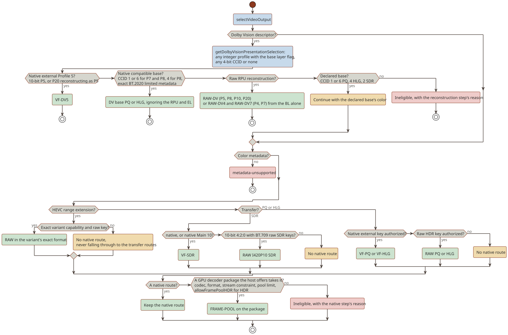
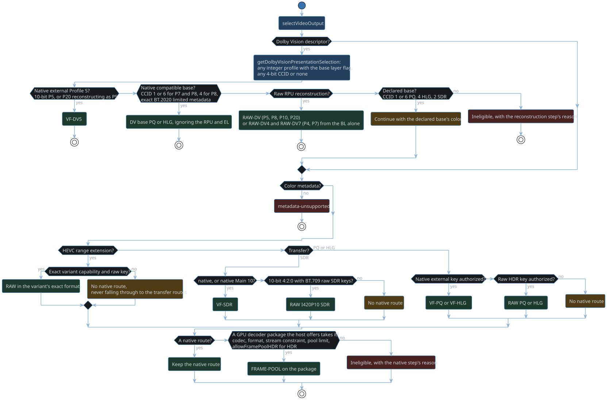
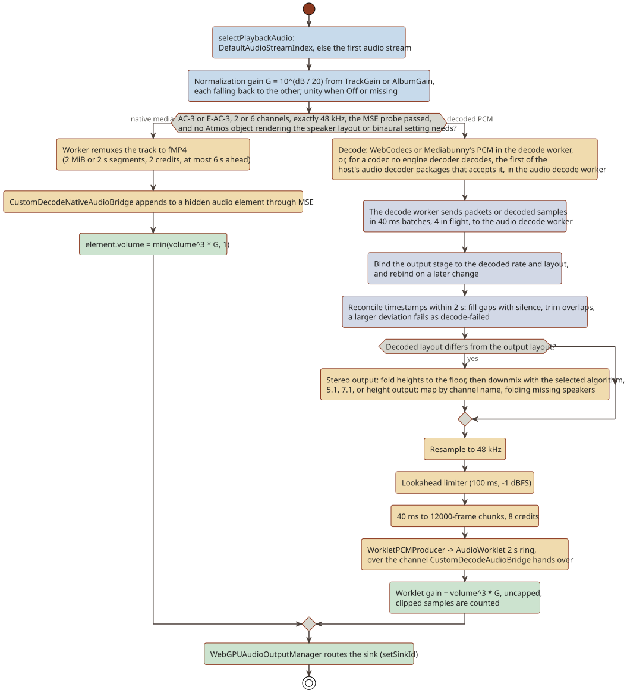
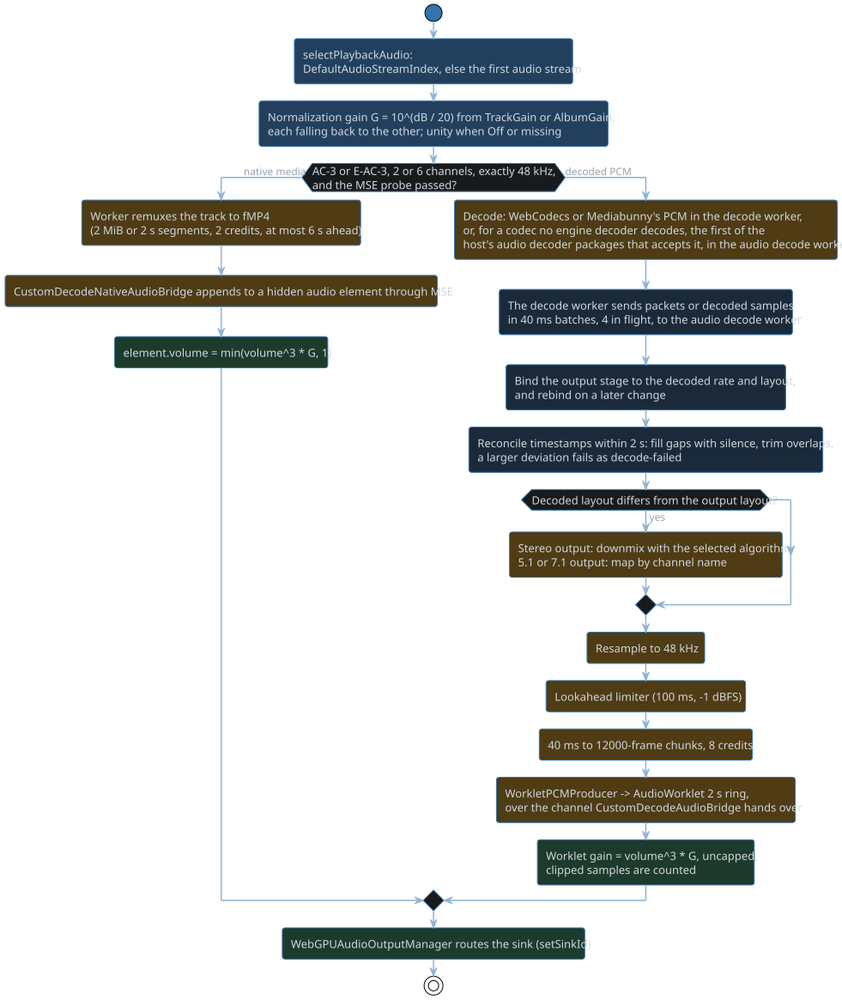

# Eligibility and routes

This chapter follows a source from the engine's capability evidence to a concrete decode and presentation route.
The host turns the same evidence into what it advertises to its server; the Jellyfin plugin's book describes its device profile.

## Host entry points

A host calls these, in this order, for each playback:

1. `CustomPlaybackEligibility.hasPotentialCustomPlaybackVideoRoute`, the metadata-only prefilter, when it chooses a player.
   The prefilter declines a source whose containers no route in `CUSTOM_CONTAINER_CODEC_RULES` carries, such as FLV, Ogg, or an MPEG program stream.
   It also declines a video codec no route decodes, such as Theora, rotated video, and interlaced HEVC and JPEG 2000, which code their fields apart (see [Interlaced video](#interlaced-video)).
2. `CustomPlaybackRuntime.getCustomPlaybackRuntimeAvailability`, which fails without a secure context, Worker, `navigator.gpu`, or `VideoFrame`.
3. `probeCustomDecodeCapabilities(item)`, the native-media audio probe, and the GPU authorizations the item needs (5 s each), before it advertises anything; see [Probes and caching](#probes-and-caching).
4. `hasEligibleCustomVideoRoute`, to ask whether the runtime would present one item with the measured capabilities and authorizations.
   It takes the GPU decoder packages a playback could use as `gpuVideoDecoderSummaries`, since offers need the packages and the presenter's device; see [GPU decoders](#gpu-decoders).
5. `getCustomPlaybackEligibility`, when the session starts, with the route flags and authorized keys of `CustomPlaybackEligibilityOptions`.
   `allowRawSDR` needs only a settled `:sdr` raw key; a key outside BT.709 authorizes on first use, so `getCustomPresentationEligibilityOptions` waits for the presented stream's own key (`getFirstUseRawSDRRouteKey`).
   `gpuVideoDecoders` holds the GPU decoder packages the host offers, from `PresentationSetup.getGPUVideoDecoderOffers`, and `allowFramePoolHDR` lets them present HDR; see [GPU decoders](#gpu-decoders).
   `audioDecoders` holds the host's audio decoder packages; see [Audio routes](#audio-routes).

## Eligibility

`getCustomPlaybackEligibility` checks in order:

1. `parsePlaybackSource`: DirectPlay, not live, a custom container, and a media `source`: a `File`, or a credential-free http(s) URL, which it resolves against the page.
   A URL source keeps the host's `hiddenContentRangePathPattern`, the paths whose cross-origin 206 hides `Content-Range` (see [Architecture](architecture.md)).
   A missing or zero `RunTimeTicks` is an unknown duration, not a rejection.
   Playback then ends with the streams, audio takes the decoded-PCM route because the native media backend needs a duration, and the worker reports the container's duration on `ready`.
2. `selectVideoStream`, and a codec the engine names.
   A codec it knows but nothing decodes, Theora, reads `video-codec-without-route`; any other unnamed codec, such as H.263+ (`h263p`), reads `codec-unsupported`.
3. Rotation 0, and a codec that keeps an interlaced stream's fields together in frames (`codesInterlacedFieldsApart`, from `presentsInterlacedVideo`).
4. `selectVideoOutput` (below), and a route that presents the stream's scan (`refusesVideoScan`).
5. `selectPlaybackAudio`.
6. `supportsCustomContainerCodecCombination`.
7. The runtime budget.

An ineligible result carries its reason, and the host falls back.

The worker refuses what only the file shows, with a message that names the check: a track whose edit list Mediabunny cannot honor (`getUnsupportedFeatures()`), an AVI video track that outruns its index (`avi-index-incomplete`), a video track Mediabunny names no codec for that no frame-pool route takes (`no decode route: fourcc: <FourCC>` for an AVI or ASF track, `codec-id: <ID>` for another container's), and a DTS Express audio track (`no decode route: dtse`).
On the frame-pool route an MPEG-TS or M2TS track of MPEG-1, MPEG-2, or VC-1 must carry the negotiated codec (`container-codec`), and takes its first sequence header's extradata as codec private data (`sequence-header-missing` when none of its first 64 packets has one).
A VC-1 or WMV3 track must be a Matroska `V_MS/VFW/FOURCC` track, an ISO base media `vc-1` sample entry (VC-1 only), or an ASF stream of `WVC1` or `WMVA` (VC-1) or `WMV3` (`codec-id`); an AVI stream of those FourCCs is refused, as no container rule places VC-1 in AVI.
An ASF stream's FourCC and extradata come from its BITMAPINFOHEADER, and its media objects, in decode order like a Matroska VfW track's, are restamped in presentation order by `VC1PresentationOrder.ts`.
An MPEG-4 Part 2, H.263, or MS-MPEG4 track must have a codec ID of the negotiated codec (`codec-id`): Matroska's `V_MPEG4/ISO/SP`, `ASP`, or `AP` and ISO base media's `mp4v` for MPEG-4 Part 2, which Mediabunny names `mpeg4` (`container-codec` otherwise), `s263` or `h263` for H.263, `V_MPEG4/MS/V3` for MS-MPEG4 v3, and Matroska's `V_MS/VFW/FOURCC`, AVI, or ASF for any of them.
A VfW, AVI, or ASF track's FourCC must be one FFmpeg's `riff.c` maps to the negotiated codec, compared upper-cased (`fourcc`), and Mediabunny leaves every such AVI or ASF track but MPEG-4 Part 2 codec-less, with the FourCC as its codec ID.
A codec-less AVI or ASF track's extradata is the one after its BITMAPINFOHEADER (`demux/VFWStreamFormat.ts`), as FFmpeg's AVI and ASF demuxers pass it.
The codec private data is a 40-byte BITMAPINFOHEADER of the track's coded size and FourCC (`mp4v`, `s263`, or `MP43` for a track without one), then the track's extradata (see [Decoder packages](decoder-packages.md)).
AVI, ASF, and Matroska VfW stamp packets in decode order, so `MPEG4PresentationOrder.ts` restamps an MPEG-4 Part 2 track from them that FFmpeg outputs one VOP late: its video object layer, from the extradata or else the first key packet, clears `low_delay` in its `vol_control_parameters`, or has none and is neither Simple nor Advanced Simple, or has none and its first group holds a B-VOP.
An I, P, or S-VOP then takes the time of the next coded VOP that is no B-VOP, passing over N-VOPs, for which FFmpeg outputs nothing, and a B-VOP keeps its own.
A JPEG 2000 track must be an MJ2 `mjp2` sample entry or a Matroska `V_MS/VFW/FOURCC` track (`codec-id`), whose FourCC must be one `riff.c` maps to JPEG 2000, compared upper-cased (`fourcc`), such as the `mjp2` FFmpeg's Matroska muxer writes.
Its blocks are bare codestreams, every one a key packet stamped in presentation order, and the decoder takes no codec private data, as FFmpeg's decoder reads no extradata.
A Matroska attachment, such as a cover image, is no track, so it never shifts the video track ordinal.
AVI audio takes the same routes as any container's: Mediabunny reads a WAVE_FORMAT_EXTENSIBLE track's codec from its SubFormat, and gives FLAC and Vorbis the decoder descriptions their `strf` extradata holds.
A track whose container declares a WAVE channel mask, which Mediabunny's `getChannelMask` reports for WAVE_FORMAT_EXTENSIBLE, is laid out by that mask: the worker takes its layout from `CustomWaveChannelLayout.ts` and passes the mask to the audio decode worker's attempt, whose output stage binds Mediabunny's decoded samples to it.
So a three-channel 2.1 track feeds its third channel to the LFE, and 3.0(back) splits it across the surround pair, as FFmpeg's decode does, where three channels without a mask are 3.0.
A mask of 0, or none, lays channels out by their count; a mask the output stage has no layout for, or one naming more or fewer speakers than the track has channels, is refused as `The selected audio channel mask is unqualified`.
Without a container mask, the host's `audioMetadataLayout` (Jellyfin's count and, where the metadata names a layout no count implies, its mask) screens the track: a metadata mask lays out the channels when it names the container's count, and Jellyfin's count replaces a container count that has no layout (`demux/CustomAudioTrackMetadata.ts`); a track neither lays out is refused as `The selected audio channel layout is unavailable`.

## Probes and caching

- Main thread: WebCodecs configuration and decoded-output probes, raw `copyTo` fingerprints, the per-profile H.264 probe, and the MSE AC-3/E-AC-3 probe.
  The engine has no decoder of its own to probe: Mediabunny's PCM decoding is always supported, and a codec only a package decodes reads `unsupported` with the reason `no-engine-decoder`.
- GPU: presentation authorization reads back renders of the production shaders.
  Results are cached per `GPUDevice`, canvas format, and shader signature, and dropped on device loss.
- `selectCustomDecodeProbes(item)` picks the probes an item needs.
  Every audio probe runs for every item, because a playing item can switch to any of its audio tracks: the stereo probes (`native-audio`), the 5.1 probes (`native-surround-audio`), and the 7.1 probes (`native-seven-point-one-audio`).
  The video probes follow the union of the video streams across the item's sources: the codec picks its native probes, a range extension picks its own variants, an H.264 stream beyond 8-bit 4:2:0 picks every raw format variant its profile codes at its depth beside the per-profile probe, since a host advertises the profile at that depth only when all of them qualify, a stream beyond 8-bit SDR adds the raw-plane and native HDR probes, and a range that is neither SDR nor static HDR adds the Dolby Vision probe.
  JPEG 2000, MPEG-2, VC-1, MPEG-4 Part 2, H.263, and MS-MPEG4 streams pick none, since only a GPU decoder package decodes them.
  An HDR item also runs the HEVC and AV1 probes, because an HDR transcode targets those codecs and their ranges bound it.
  An item without stream metadata, or with a video stream that names no codec, runs every probe.
- A probe the item does not select reads `not-probed`, which no profile rule or eligibility check treats as support, and its H.264 profile result is absent; `probeStates` records which probes a result ran.
  At eligibility, the host keeps the negotiated result when `hasProbedCustomDecodeSelection` says it covers the played source, and otherwise probes that source.
- A range-extension or raw-format probe downloads its vector before its decode timeout starts, under its own 30 s bound (`capability/CapabilityAssetLoading.ts`), so a slow link never reads as a slow decoder or trips the queue's timeout.
  A download that fails with a network error, 408, 429, or 5xx is retried after 250 ms and again after 1 s, inside the same 30 s bound; any other HTTP failure, or the bound ending, is final and reports `asset-unavailable` with an unknown status.
- Each probe is one promise per page, so a later item runs only the probes no earlier item ran.
  It is dropped only when the store clears a stored verdict it holds, or replaced when a background rerun reaches a new verdict.
  `SerializedHeavyCapabilityProbeScheduler` runs the heavy probes one at a time, audio first; after one a negotiation started times out, later heavy probes report a timeout until the page reloads.

### Background probes

A host may start the probes before its first negotiation with `warmCustomDecodeCapabilities()`, and tells the engine when media plays with `configureCustomDecodeCapabilityBackground({ isPlaybackActive })`.

- The warm-up runs every probe without a page result or stored verdict, one probe after another, in the order a full run starts them.
  A client whose `navigator.connection.saveData` is set, or whose `navigator.hardwareConcurrency` is below 4, gets no warm-up.
- Before a background probe starts, and before each of its heavy steps joins the queue, it waits for its turn: a `requestIdleCallback` with a 2 s timeout (`BACKGROUND_PROBE_IDLE_TIMEOUT_MILLISECONDS`), then no media playing, no negotiation under way, and none settled in the last 10 s (`BACKGROUND_PROBE_NEGOTIATION_HOLD_MILLISECONDS`); a held step looks again after 1 s.
  Without `requestIdleCallback`, as on WebKit, the wait is the whole 2 s.
  The wait comes before a step joins the queue, so it never counts against the step's 2 s timeout, and it never holds the queue for a negotiation's steps.
- A background probe downloads its range-extension vector with `fetch(..., { priority: 'low' })`, retries included.
- `probeCustomDecodeCapabilities` promotes a background probe it needs: its remaining steps skip the wait, and its later downloads take the default priority; a download already under way keeps its priority.
  A probe no background run started runs at once, as without a warm-up, so a negotiation waits for at most the one background step already in the queue.
- A background step that times out marks only its run and halts the background for the page: no later background step runs, and the run's result, like any background result with a `probe-timeout` part, is discarded rather than kept as the page's result.
  The scheduler's timeout poison stays unset, and a negotiation that needs the probe runs it again.

### Stored verdicts

`capability/CapabilityProbeStore.ts` keeps verdicts across page loads and browser restarts, in one localStorage entry, `webgpu-player-capability-probe-verdicts`.

- A host names its build with `configureCapabilityProbeStore({ buildKey })`, as it calls `configureEngineAssets`; until then nothing is read or written.
- The entry holds a schema version (`CAPABILITY_PROBE_STORE_SCHEMA_VERSION`), the fingerprint, the time of its last write, and each probe's result by its `CustomDecodeProbe` name.
- The fingerprint is the build key, the default adapter's `info`, its sorted `features`, and its `limits`, `navigator.userAgent`, and Chromium's `getHighEntropyValues(['fullVersionList', 'platformVersion'])`, compared as JSON with sorted keys.
  A fingerprint that cannot be read within 2 s disables the store for the page.
- An entry of another schema or fingerprint is a miss, and the next write replaces it, so an update leaves no other entry behind.
- A result is written only when every status in it is `supported` or `unsupported`; one with any `unknown` or `not-probed` part, from a timeout, an exception, or a missing API, is not.
  Writes merge, so the video probes of each item a page negotiates join the entry.
- `CustomDecodeCapabilityProbe` reads a probe's stored verdict before running it.
  A hit answers at once and schedules the probe to run again in the background, which overwrites the stored verdict and the page's result when it reaches a verdict; a rerun that reaches none leaves both.
- A start that falls back with `decode-failed` or `startup-timeout` before its first frame clears the entry and the stored verdicts the page holds, when the page used any (`clearAfterStartFailure`, from `CustomPlaybackController`), so the renegotiation probes again.
  Driver updates, OS codec packs, the hardware acceleration setting, and Chrome's software fallback after a GPU process crash change no fingerprint.
- `clearStoredCapabilityProbeVerdicts()` clears it, and `readStoredCapabilityProbeVerdictState()` returns the stored fingerprint, write time, age, and probe names.
- The MSE AC-3/E-AC-3 probe and the GPU presentation authorizations are not stored: the first is not a `CustomDecodeProbe`, and the second are measured on the presenter's device, which keeps them for that device.

## Route catalog

| Backend literal | Output | Qualifying evidence | Gate |
| --- | --- | --- | --- |
| `native` SDR | `video-frame` | H.264 per-profile keyframes; HEVC 1080p access unit; VP8, VP9, AV1 64x64; 4K variants | `getOrdinarySDRVideoSelection` |
| `native` HEVC Main 10 and AV1 Main 10 HDR, Dolby Vision base | `video-frame`, with `nativeHDRTransfer` pq or hlg, neutralized | 4K Main 10 decode (`nativeHDRHEVC`, `nativeHDRAV1`), plus that codec's external HDR or the Dolby Vision GPU authorization | `getNativeHDRVideoCodec`, `selectNativeDolbyVisionBaseOutput` (HEVC only) |
| `native` raw | `raw-planes`: I420P10 for HDR, 10-bit SDR, and Dolby Vision (HEVC Main 10, AV1 Main, VP9 Profile 2), I420 to I444P12 for range extensions, for AV1 outside Main 10, and for H.264 beyond 8-bit 4:2:0 | `copyTo` plane fingerprints; nine 192x192 two-access-unit range-extension probes, eight 192x192 two-temporal-unit AV1 raw format probes, and five 192x192 I, P, B H.264 raw format probes, whose B frame outputs before the P frame; raw GPU authorization | `supportsRawHDRVideo`, `selectHEVCRangeExtensionVideoOutput`, `selectAV1RawFormatVideoOutput`, `selectH264RawFormatVideoOutput` |
| `gpu` | `frame-pool`: I420 to I444P12, the stream's own format | None at eligibility: a host offers its GPU decoder packages, whose own vectors run only when the host verifies one | `selectGPUVideoOutput`; native wins |
| Audio decoder package | `decoded-pcm` | None at eligibility: a host offers its audio decoder packages | `findAudioDecoderPackage`, for a codec no engine decoder supports |
| Mediabunny PCM | `decoded-pcm` | None at runtime; always marked supported | `isSupportedCustomAudioInputLayout` |
| MSE AC-3/E-AC-3 bridge | `native-media` | `isTypeSupported`, an fMP4 append, playback advancing; 2 or 6 channels at 48 kHz | `getSupportedNativeMediaAudioRoute`, checked first |
| WebCodecs aac, opus, flac, mp3, vorbis | `decoded-pcm` | Stereo 48 kHz silence vectors; separate 5.1 silence vectors; separate 7.1 tone vectors whose decoded planes must carry each source channel's tone in WAVE 7.1 order | `capabilities.audio[codec]`, `nativeSurroundAudio[codec]` for 6 channels, `nativeSevenPointOneAudio[codec]` for 8 |

## Video route selection

`selectVideoOutput` tries these in order.

1. A Dolby Vision descriptor.
   `PresentationInput.getDolbyVisionPresentationSelection` accepts any integer profile with the base layer flag set, a valid bit depth, and any 4-bit compatibility ID (CCID) or none; the EL flag never rejects.
   The descriptor names the RPU route (`reconstructionProfile`): Profiles 4, 5, 7, and 8 as signaled; Profiles 10 (AV1) and 20 as 5 with CCID 0 or none and as 8 otherwise; none for Profile 9, the retired profiles, or a stream without an RPU.
   RPU reconstruction ignores the CCID, which only declares a base layer that can be shown on its own.
   The Dolby Vision routes, in order:
   1. Native external Profile 5: a 10-bit HEVC P5, or a P20 that reconstructs as P5.
   2. Native external AV1 Profile 10 (`selectNativeAV1DolbyVisionOutput`): a 10-bit Main P10 reconstructs as P5 or P8 from the hardware decoder's frames, every sequence header neutralized to limited BT.709, whatever base the CCID declares.
      It needs `nativeHDRAV1`, the AV1 PQ external key, which proves the AV1 decoder's frames import exactly, and the external key of the profile it reconstructs as: `allowNativeDolbyVision` for P5, `allowNativeDolbyVisionProfile8` for P8.
      `getCustomPresentationEligibilityOptions` waits for the AV1 PQ key and the P8 key on first use.
   3. The native compatible base, HEVC only, when the CCID declares one: HDR10 (1) or Ultra HD Blu-ray (6) for P7 and P8, and HLG (4) for P8.
      The RPU and EL are ignored.
      This needs exact BT.2020 limited base metadata with explicit transfer, primaries, and matrix.
      A separate-track P7 base is a standalone HDR10 track, so it qualifies whatever CCID the EL track reports.
   4. Raw RPU reconstruction.
      The base layer decodes natively to `raw-planes`: I420P10 for HEVC Main 10 and for AV1 Main at 10 bits, or the exact format of any range-extension variant or AV1 raw format variant, such as I420 for AV1 Main at 8 bits.
      HEVC Main at 8 bits has no native raw route, so its RPU route is ineligible.
      Single-layer routes (P5, P8, P10, P20) discard a signaled EL.
      No decoder decodes an EL, so dual-layer routes (P4, P7, HEVC only) reconstruct from the base layer alone: MEL is exact, and FEL presents its base layer.
      The worker still pairs a separate EL track to read its RPUs, and the presenter keeps its FEL composition for an EL decoder, which no route reaches.
   5. The declared base layer (`getDolbyVisionBaseColorMetadata`), through the ordinary steps below, where a GPU decoder's RPU reconstruction (step 6 of this list) comes before the base's own GPU route.
      CCID 1 or 6 declares PQ, 4 HLG, and 2 SDR, never for P5 or a P20 that reconstructs as P5.
      An explicit ColorTransfer must agree with the CCID; VideoRange and VideoRangeType are ignored.
   6. Without a declared base, RPU reconstruction from a GPU decoder's frame pool (see [GPU decoders](#gpu-decoders)).
   7. Otherwise the source is ineligible, with the reason from the reconstruction step.
2. No color metadata: `metadata-unsupported`.
   `PresentationInput.parseVideoStreamColorMetadata` reads ColorTransfer, ColorPrimaries, ColorSpace, and ColorRange.
   A field that is `unknown`, `unspecified`, or `reserved` is absent and takes its transfer's default: BT.709 for SDR, BT.2020 for PQ and HLG, and limited range.
   The BT.2020 10 and 12-bit transfers read as SDR, SMPTE 170M and SMPTE 240M primaries as `smpte170m`, BT.470 BG primaries as `bt470bg`, and the SMPTE 170M and BT.470 BG matrices as BT.601.
   Any other value is unrecognized and fails.
3. An HEVC range extension needs its exact variant capability and raw key, and so does AV1 outside Main 10 (High 4:4:4, Professional 4:2:2 or 12 bits), through `av1RawFormats[variant]`.
   So does H.264 beyond 8-bit 4:2:0 through `h264RawFormats[variant]`: a profile beyond High (High 10, High 4:2:2, High 4:4:4 Predictive, their Intra profiles, High 4:4:4, or CAVLC 4:4:4) whose pixel format is one of the five variants, I420P10, I422, I422P10, I444, or I444P10, and one the profile codes.
   The SDR keys go by matrix, primaries, and range, and 10-bit PQ or HLG takes the raw HDR key of the variant's format.
   A range extension or a raw format variant never falls through to steps 4 and 5; a profile beyond High at 8-bit 4:2:0, 9, 12, or 14 bits, 4:0:0, or RGB has no variant and no other route, so it is refused.
4. SDR: `native`, or native Main 10 SDR.
   Then, for 10-bit 4:2:0 SDR that neither decodes (AV1 Main, VP9 Profile 2, or HEVC Main 10 without native decode), raw I420P10 through the raw SDR key of its matrix, primaries, and range.
   JPEG 2000, MPEG-1, MPEG-2, VC-1, WMV3, MPEG-4 Part 2, H.263, and MS-MPEG4 have no native route (`CUSTOM_PACKAGE_VIDEO_CODECS`).
5. PQ or HLG: native external first, through the stream's codec's key (`external-hevc-main10-bt709-limited:<pq|hlg>-v1` for HEVC Main 10, `external-av1-main10-bt709-limited:<pq|hlg>-v1` for AV1 Main at 10 bits), then raw (`<I420P10|I420P12>:bt2020-ncl:bt2020:limited:<pq|hlg>`).
   The worker rewrites the HEVC SPS VUI to BT.709 at the stream's own range, or every AV1 sequence header, the codecs string, and an `av1C` description to limited BT.709, so Chrome converts the hardware frame without tone mapping; each rewritten HEVC SPS must declare BT.2020 with the non-constant-luminance matrix and the route's transfer, at either range, and each AV1 header limited BT.2020 with them, or the attempt fails.
6. When steps 3 to 5 chose no route, a GPU decoder package the host offers takes the stream, if one does; otherwise the source is ineligible with the reason those steps gave.

## GPU decoders

The `gpu` backend decodes on the presenter's device with a GPU decoder package's WGSL; the `frame-pool` output presents its pool slots without a copy.
A package may carry a parser module (`//! parser:`), which the selection carries to the decode worker's start as `gpuVideoParser`: the HEVC decoder project's parser parses each packet into the GPU record its WGSL reads.
`PresentationSetup.getGPUVideoDecoderOffers` offers the host's packages that accept the stream's codec and write its output format, in the host's order, with the presenter's buffer limit; it verifies nothing.
`selectGPUVideoOutput` takes the first offer for the stream's codec that meets each of these:

- The output format: a range extension's own, else the one that holds the stream's pixel format (`getGPUDecoderPixelFormatHolding`: yuv422p is I422, and 9-bit samples take the 10-bit format, shifted up), else 4:2:0 at the stream's bit depth.
  An explicit BitDepth must agree with the pixel format's samples, and a pixel format no frame pool holds, such as RGB or 4:1:1, has no route.
  JPEG 2000's `xyz12le`, the Digital Cinema profiles' X'Y'Z', takes I444P12, into which the JPEG 2000 package writes it as limited-range BT.709 Y'CbCr, so it needs a stream whose color metadata is BT.709 SDR at limited range, as an untagged stream's is.
- For a 4:0:0 pixel format, such as gray10le, which takes the 4:2:0 format of its depth: a decoder whose header declares `monochrome`.
- The decoder's stream constraint, over the pool's coded size and the format's bit depth.
  The pool takes the container's coded size rounded up to 64 (`GPU_DECODE_POOL_CODED_SIZE_ALIGNMENT`), the largest coding block, and the decoder's header crops it, such as by a conformance window.
  A session may code larger, at the largest picture its parser declares (see [How a session decodes](decoder-packages.md#how-a-session-decodes)), but eligibility checks the container's size.
- The frame pool, the decoder's `state` and `buffer:`s, and its packet ring each fit the device's buffer limit (`maximumBufferByteLength`), the smaller of its largest buffer and its largest storage binding: the HEVC decoder project's package holds 29 slots, which in I420P10 at 3840x2176 is about 727 MB.
  `findGPUDecoderStreamFitFailure` checks them.

Static HDR needs `allowFramePoolHDR`, which the host sets when it tone-maps.

A Dolby Vision stream with an RPU route reconstructs on the route too, with `dolbyVisionProfile` set, when the host authorized that route (`allowDolbyVision`, `allowDolbyVisionProfile4`, or `allowDolbyVisionProfile7`, from the raw route's key of the BL format) and an offer writes the format the RPU route names: the range extension's own, I420 for HEVC Main, or I420P10 for HEVC Main 10 and AV1 Main at 10 bits.
`allowFramePoolHDR` plays no part in it.
The worker parses each packet's RPUs, as on the raw route, a separate EL track's included, and each frame carries its packet's RPUs through the GPU decode session to the presenter; a repeat of the last good frame carries that frame's.
The presenter reconstructs the slot through the raw route's reconstruction (`FramePoolDolbyVisionSignal.ts`), gated by the same base key, and no frame pool holds an EL, so Profiles 4 and 7 reconstruct from their BL alone.
`getGPUVideoDecodeTarget` names the RPU route's format, so a host fetches packages for a stream without a declared base.

`hasEligibleCustomVideoRoute` holds no offers, so a `GPUVideoDecoderSummary` (`src/decode/video/gpu/GPUVideoDecoderCatalog.ts`) stands in for one, after the offers, and selects the route without a decoder.
A summary names the package's codecs and output formats, and may carry the package's header and the buffer limit of the device a playback would decode on.
`isGPUVideoDecoderSummaryFit` judges the stream as an offer would: by codec and format, then with a header by `monochrome` for a 4:0:0 stream and the `accepts` conditions, and with a limit by the frame pool, `state`, `buffer:`s, and packet ring.
A summary without a header takes every stream of its codecs and formats, and leaves the other checks to the playback's offers.

A package's self-test vectors run only when a host calls `verifyGPUDecoderPackage` (see [Decoder packages](decoder-packages.md)); eligibility never waits on them, and offering an unverified package is the host's choice.

VP9, HEVC range extensions, and H.264 beyond 8-bit 4:2:0 present HDR only through raw planes, and AV1 keeps its raw route beside its native external one, so a host must settle the raw HDR keys for them whatever the external result.
The AV1 external keys authorize on first use: `getCustomPresentationEligibilityOptions` waits for the key of an AV1 HDR stream's transfer before eligibility, through `WebGPUPresenter.waitForExternalHDRRouteAuthorization`.
The Dolby Vision keys a source needs on first use (Profile 4 in any format, or Profile 7 or single-layer reconstruction in a format other than I420P10) must settle before eligibility.

## Interlaced video

Every route but Dolby Vision's presents interlaced video through the deinterlacing pass (see [Architecture](architecture.md#deinterlacing)), so eligibility refuses interlaced video only where no route can present it, as `interlaced-video-unsupported`:

- `IsInterlaced` true on HEVC, which codes interlaced video as field pictures, and on JPEG 2000, which codes a codestream per field: no decoder weaves their fields into frames, and the pass deinterlaces frames whose rows alternate between the fields.
  The check runs before route selection, and the prefilter declines the same streams.
- A Dolby Vision route, whose profiles are progressive and which never deinterlaces, unless `IsInterlaced` is false.
  A Dolby Vision stream whose declared base layer takes an ordinary route presents through that route's deinterlacing.

H.264, MPEG-2, MPEG-4 Part 2, VC-1, and WMV3 decode interlaced video into woven frames, so they are eligible whatever `IsInterlaced` says, and a missing or malformed `IsInterlaced` is an unknown scan, which each frame's own fields settle.
MPEG-1, H.263, MS-MPEG4, VP8, VP9, and AV1 have no interlaced coding.
`presentsInterlacedVideo(codec)` exports the per-codec answer, so a host's negotiation offers interlaced streams of exactly those codecs, outside its Dolby Vision labels.

| Route | Interlaced video | Field order from |
| --- | --- | --- |
| Native `VideoFrame` (`external-texture`, `external-hdr`) | Deinterlaced; the browser upsampled its chroma progressively | The container's scan, else the host's `FieldOrder` and `IsInterlaced` |
| Raw planes (`raw-yuv`) | Deinterlaced, 4:2:0 chroma read within each field | As the native route; an H.264 raw format variant decodes through the same sample path as native H.264, so its frames carry the same fields |
| GPU (`frame-pool`) | Deinterlaced, 4:2:0 chroma read within each field | The decoder's `reportPictureFields`, else its parser's `parser_picture_fields`, else as the native route |
| Dolby Vision (`external-dolby-vision`, `raw-dolby-vision`) | Refused unless `IsInterlaced` is false | None |

## Route keys

- Raw: `<I420P10..I444P12>:bt2020-ncl:bt2020:limited:<pq|hlg>` and `<I420..I444P12>:<matrix>:<primaries>:<full|limited>:sdr`, with every matrix (`bt709`, `bt470bg`, `smpte170m`, `bt2020-ncl`) and primaries set (`bt709`, `bt470bg`, `smpte170m`, `bt2020`).
  The HDR keys and the BT.709 SDR keys are prewarmed; every other SDR key authorizes on first use, and its vector doubles the chroma excursion so the gamut conversion moves its samples beyond the tolerance.
- External HDR: `external-hevc-main10-bt709-limited:<pq|hlg>-v1`, prewarmed, and `external-av1-main10-bt709-limited:<pq|hlg>-v1`, authorized on first use, each with its own codec's vector.
- Dolby Vision raw, each per BL format from I420 to I444P12: `<format>:dovi-rpu-v1`, `<format>:dovi-profile4-base-v1`, `<format>:dovi-profile4-fel-v1`, `<format>:dovi-profile7-base-v1`, and `<format>:dovi-profile7-fel-v1`.
  Only `I420P10:dovi-rpu-v1` and the I420P10 Profile 7 keys are prewarmed; the others authorize on first use.
- Dolby Vision external: `external-I420P10-bt709-limited:dovi-p5-rpu-v1`, prewarmed, and `external-I420P10-bt709-limited:dovi-p8-rpu-v1`, which only AV1 P10 uses and which authorizes on first use; both check the same shader with their profile's synthetic RPU.

## Audio routes

- Track: `DefaultAudioStreamIndex`, else the first audio stream by index.
  The worker selects it by its ordinal among the container's audio tracks, which skips the streams Jellyfin lists for external files (`IsExternal`), as the video ordinal does.
  A selected external audio stream is `audio-track-external`, since only the server can mux an external file in.
  Codec aliases: DCA is dts, EC-3 is eac3, TRUE-HD is truehd; WMA takes FFmpeg's decoder names, wmav1, wmav2, wmapro, wmalossless, and wmavoice.
- Order: an E-AC-3 or TrueHD stream whose Jellyfin `Profile` names Atmos takes the first offered package that declares `renderChannelMask` when the host's `audioRenderTarget` needs its objects: a height speaker layout, a floor wider than the declared channels (7.1 from a 5.1 core), or binaural headphones on a stereo layout; the declared layout must still pass the codec's input routes, and the eligibility sets `audioRendersObjects`.
  Otherwise the native-media MSE bridge for AC-3 and E-AC-3 (2 or 6 channels, exactly 48 kHz) comes first.
  Otherwise `decoded-pcm`: through the engine's own decoders when the codec capability and the input layout qualify, the browser's for WebCodecs codecs and Mediabunny's for PCM.
  A codec no engine decoder supports, AC-3, E-AC-3, DTS, TrueHD, MLP, and WMA among them, takes the first of the host's audio decoder packages whose manifest accepts it.
- Input channels, as declared by Jellyfin.
  The decoded format is authoritative at runtime, and any decoded layout maps to the output by channel name:

  | Codec | Channels |
  | --- | --- |
  | PCM | 1, 2, 3, 6 (3 needs a `3.0` layout) |
  | aac, flac, opus, vorbis | 1, 2, 3, 6, 8 (3 needs a `3.0` layout, or `2.1` for FLAC, laid out by its mask; 6 needs the codec's 5.1 verdict and 8 its 7.1 verdict) |
  | ac3 | 1, 2, 5, 6 (2/1 and 3/0 both arrive as `3.0`, and no evidence covers either; 5 is 3/2, `5.0(side)`) |
  | eac3 | 1, 2, 6, 8 |
  | mp3 | 1, 2 |
  | dts | 1, 2, 3, 5, 6, 7, 8 (4.1 and 5.0 arrive with 5, 6.1 with 7) |
  | truehd | 1, 2, 6, 8 (8 only at 48 kHz) |
  | mlp | 1, 2 |
  | wmav1, wmav2 | 1, 2 |
  | wmapro, wmalossless | 1, 2, 3, 6, 8 |
  | wmavoice | 1 |

  Jellyfin keeps only the part of FFmpeg's layout name before `(`, so `3.0(back)` arrives as `3.0` and `7.1(wide)` as `7.1`.
  A package reports each block's speaker mask, so the mask, not the declared layout, tells them apart at runtime: a DTS 3.0(back) plays with its back center on the surrounds, and a mask with no output layout fails the attempt as `decode-failed`, which renegotiates.
  DTS-ES's XCh and a lossless 6.1 bed decode to the WAVE 6.1 mask, which plays with its back center split across the surround or back pair; a DTS 4.1 plays the same way, and a mask with no layout, such as 4.0, fails the attempt.
  Seven-channel WMA Pro and WMA Lossless still have no route, since their input table leaves 6.1 out.
  An 8-channel AAC, Opus, FLAC, or Vorbis track declares no mask, so it lays out by its count as WAVE 7.1 (`CUSTOM_SEVEN_POINT_ONE_CHANNEL_LAYOUT`), the order its 7.1 probe proved.
  FFmpeg's encoder writes 7.1 AAC as AudioSpecificConfig channelConfiguration 7, which FFmpeg's decoder, and so Chrome's, reads as 7.1 with back and side pairs, not the specification's 7.1(wide); either reaches the engine as `7.1`.
- DTS and TrueHD play from Matroska and from MP4, M4V, and MOV (the `DTS `, `dtsc`, `dtsh`, `dtsl`, and `mlpa` sample entries); MLP plays only from Matroska.
- WMA plays from Matroska `A_MS/ACM` tracks and AVI and ASF streams, which Mediabunny leaves codec-less: the worker reads the WAVEFORMATEX (`demux/WaveFormatAudioConfiguration.ts`), names the codec by its format tag, and refuses a track whose tag names another codec than the package decodes it as.
  The package configures with that WAVEFORMATEX before its first packet (see [Decoder packages](decoder-packages.md#codec-private-data-1)).
- Rates: any positive integer, resampled to 48 kHz.
  Past 192 kHz the resampler's kernel widens in proportion, so its band edge stays as sharp as at 192 kHz.
  A browser decoder judges its own rates per item, and a rate it refuses falls back.
- Output layout (`audio/NativeMultichannelAudioOutput.ts`): `selectCustomAudioSpeakerLayout` resolves the host's speaker layout setting on `destination.maxChannelCount`: `auto` takes 7.1.4 from 12 channels, 7.1.2 from 10, 7.1 from 8, 5.1 from 6, else stereo; an explicit stereo, 5.1, 7.1, 5.1.2, 5.1.4, 7.1.2, or 7.1.4 needs a destination with its channels, else resolves as `auto`.
  `selectCustomAudioOutputLayout` then gives a source a package renders as objects the whole speaker layout, and every other source the floor rule within the layout's floor: three channels, 5.0, and 5.1 take 5.1, 6.1 and 7.1 take 7.1 or fold into 5.1, everything else downmixes to stereo with the selected algorithm.
  A host may force stereo.
  A live layout switch applies the same rule to the decoded layout.
  The output plays 2, 6, 8, 10, or 12 channels in WAVE order (5.1 in Web Audio's order); a decoded layout maps by channel name, a 5.0 bed fills 5.1 without its LFE and mixes to stereo as that 5.1, a height the output lacks folds into the floor pair beneath it, and a height layout mixes to stereo through its folded floor.

## Gotchas

- Native decode uses the hint its probes measured (`getCustomDecodeHardwareAcceleration`).
  Only the routes that present the decoder's opaque hardware output (native external HDR, the native Dolby Vision base, and external Profile 5) prefer hardware.
  Raw-plane AV1 and VP9 prefer software, because Chromium's hardware decoders return opaque 10-bit surfaces, and so does raw-plane H.264, whose profiles beyond High Chromium reports unsupported with `prefer-hardware`.
  Every other native route uses `no-preference`, so a codec without a hardware decoder, such as VP8 in Chromium on Windows, decodes in software.
  One exception: 10-bit SDR HEVC has no probe of its own.
  The native HDR HEVC probe gates it with `prefer-hardware`, while the SDR route requests `no-preference`.
  Chromium decodes HEVC only in hardware, so both resolve to the same decoder.
- Eligibility checks no audio profile: a stream a package cannot decode, such as DTS-UHD in a DTS package, fails its attempt at runtime as `decode-failed`.
- A raw SDR stream outside BT.709 primaries converts its gamut to BT.709 in the raw shader (`builtin.sdr-gamut`), as the frame-pool route does, while the native VF-SDR route leaves the conversion to the browser.
